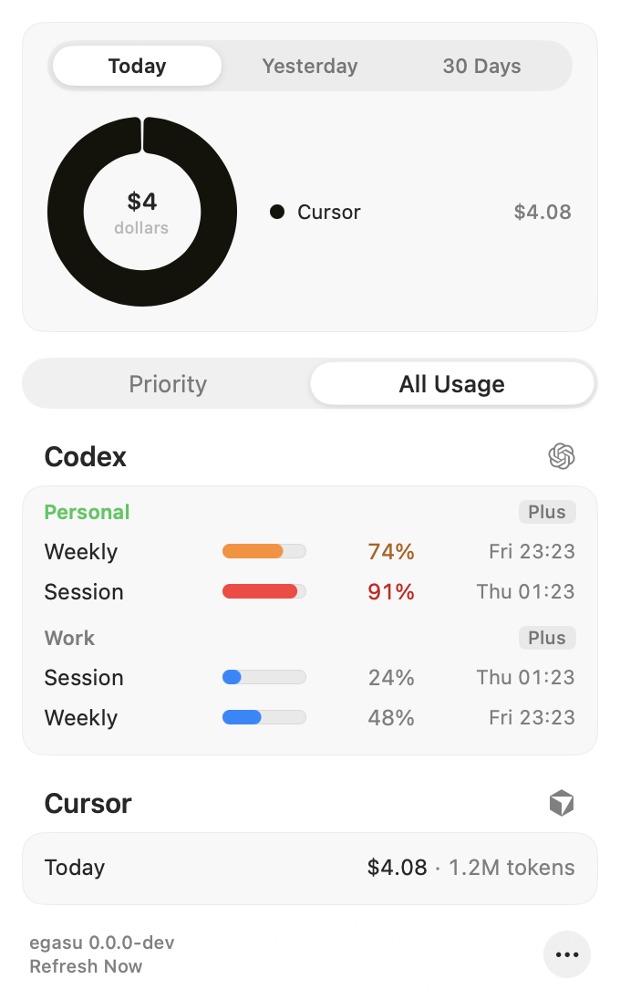
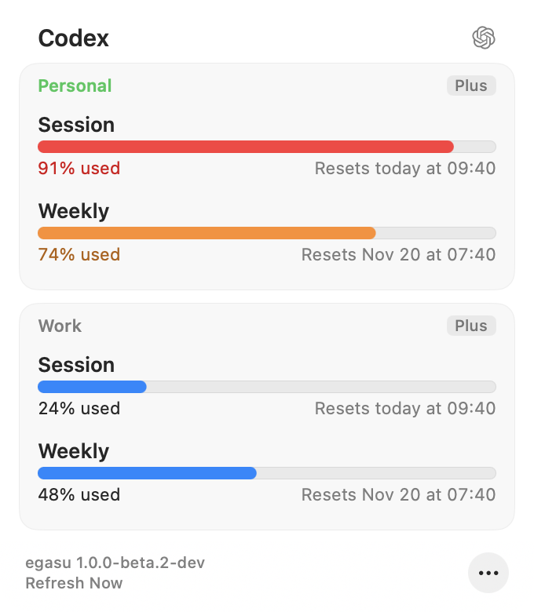

# egasu

macOS 메뉴 막대에서 AI 코딩 구독 사용량을 확인하는 Swift 앱.

세션·주간 한도, 크레딧과 지출을 한 패널에서 확인.
메뉴 막대에는 소진 임박, Priority, 직접 고정한 지표 중 선택한 기준으로 표시.

| Minimal | Cards |
|---|---|
|  |  |

## 설치

macOS 15(Sequoia) 이상 필요.
DMG 하나로 Apple Silicon과 Intel Mac 모두 지원.

1. 정식 버전은 [최신 정식 릴리스](https://github.com/kimchanhyung98/egasu/releases/latest)의 **Latest** 항목에서, 베타 버전은 [전체 릴리스](https://github.com/kimchanhyung98/egasu/releases)의 **Pre-release** 항목에서 DMG 다운로드.
2. DMG에서 앱을 응용 프로그램 폴더로 드래그.
3. 응용 프로그램 폴더에서 egasu 실행.

Spotlight에서도 `egasu`, `openusage`, `usage`로 검색해 앱 실행 가능.

설치한 앱에서 베타 업데이트를 받으려면 **설정 → 일반 → 업데이트 → 베타 업데이트** 켜기.
영어 화면에서는 **Settings → General → Updates → Beta Updates** 선택.
서명과 Apple 공증을 마친 새 버전은 [Sparkle로 앱 안에서 업데이트](/docs/updates.md) 가능.

## 지원 프로바이더

- **[Claude](/docs/providers/claude.md)** — 세션·주간·모델별 한도, 추가 사용량, 로컬 기록의 일별 지출·토큰.
  OAuth 갱신은 기존 로그인 권한 범위 유지.
  앱은 종료 요청을 받으면 진행 중인 OAuth 갱신 처리가 끝날 때까지 대기.
  CLI 인증 실패 후 남은 토큰에 조회 권한이 없으면 같은 계정의 Desktop 로그인 확인.
- **[Codex](/docs/providers/codex.md)** — 기본·Spark 풀의 세션·주간·월간 한도, 추가 사용 및 한도 재설정 크레딧, 로컬 기록의 일별 지출·토큰.
  재설정 크레딧 상세에는 만료 시각별 수량과 만료 시각을 확인할 수 없는 수량 표시.
- **[Cursor](/docs/providers/cursor.md)** — 일반 요금제의 전체·Auto·API 사용량, 통합 계정의 주간 공유 한도·선불 잔액·월간 추가 사용액, 서버 보고 기반 지출·토큰.
  추가 사용액과 상한은 같은 개인·팀 범위로 표시.
  요금제 조회에 실패해도 청구 정보에서 통합 계정이 확인되면 통합 지표 표시.
  회복 알림은 구독 한도·요청 수·월간 추가 지출 상한을 개별 판정하고 개인·팀 한도를 따로 비교.
  이력 조회 실패 시 같은 계정으로 확인한 마지막 정상 이력 유지.
- **[Antigravity](/docs/providers/antigravity.md)** — Gemini 풀과 Claude 등 다른 모델 풀의 5시간·주간 한도, 계정별 Argon 주간 한도와 로컬 사용 이력.
- **[Copilot](/docs/providers/copilot.md)** — AI 크레딧, 추가 사용량, 조직 사용량·청구액, 채팅·코드 완성 할당량.
- **[Devin](/docs/providers/devin.md)** — 일간·주간 할당량, 추가 사용 잔액.
- **[Grok](/docs/providers/grok.md)** — 결제 기간별 주간·월간 공유 한도, 종량제 지출 상한, 로컬 기록의 일별 지출·토큰.
- **[Kimi](/docs/providers/kimi.md)** — 5시간·주간·월간 총한도, 추가 지출·잔액.
  세션 사용량이 0%여도 서버가 보고한 초기화 시각 표시.
  미충전 지갑의 금액도 0으로 표시.
  세션 한도만 있어도 게시 전 로그인 유지 여부 확인.
- **[Kiro](/docs/providers/kiro.md)** — 코딩 크레딧과 구독 요금제.
- **[OpenCode](/docs/providers/opencode.md)** — Go 서버의 세션·주간·월간 사용률, Console과 Go의 로컬 지출·토큰.
  과거 Zen 기록도 Console 집계에 포함.
- **[OpenRouter](/docs/providers/openrouter.md)** — 크레딧 잔액과 일간·주간·월간 지출.
- **[Z.ai](/docs/providers/zai.md)** — GLM Coding Plan의 세션·주간·월간 할당량과 웹 검색 한도.

대부분의 프로바이더는 Mac의 Keychain, 인증 파일 또는 앱에 저장된 로그인 정보 재사용.
[OpenRouter](/docs/providers/openrouter.md)와 [Z.ai](/docs/providers/zai.md)는 앱에 저장하거나 지원 환경 변수로 제공한 API 키 사용.
쓸 수 있는 키가 없고 저장 파일을 읽지 못하면, 미등록 상태와 구분해 파일 접근 오류 표시.
기존 설정 파일의 형식을 인식할 수 없으면 내용을 보존하고 API 키 저장 오류 표시.
계정 제거 시 설정 파일의 API 키를 제거하고, JSON의 다른 설정은 보존.
인증 정보는 해당 프로바이더 요청에만 사용.
익명 요약과 공개 가격표 다운로드는 [개인정보 및 사용 데이터](/docs/privacy.md) 참조.

## 주요 기능

- **[메뉴 막대](/docs/menu-bar.md).** 소진 임박·Priority·직접 고정한 항목 중 표시 기준 선택.
  텍스트 또는 막대로 최대 5개 표시.
  설정 → 표시의 **메뉴 막대 표시 항목** 옆 ⓘ에서 지표 고정 방법 확인.
- **[Priority](/docs/dashboard.md#priority).** 고정한 지표, 소진 임박·초기화 전 사용·소진 완료에 해당하는 한도, 확인이 필요한 계정 표시.
  표시할 지표가 없으면 **전체 사용량 보기**로 이동.
  Claude 로그인 반영 중 키체인 접근에 실패하면 우선순위의 **해결** 버튼으로 재시도.
  설정 → 알림에서 네 조건의 **우선순위 표시**를 모두 끄면 대시보드에 전체 사용량만 표시.
- **[All Usage](/docs/dashboard.md#all-usage).** 등록 계정별 사용량·초기화 시각·사용 속도 표시.
  Minimal은 프로바이더별 계정 묶음, Cards는 계정별 독립 카드.
  실험실에서 Claude·Codex 계정 전환 추천을 선택해 사용.
  추천 시작 사용률·후보 사용률 제한을 설정하며, 기본값은 끄기·95%·90%.
  닫은 추천은 출발·대상 계정 중 하나의 5시간 세션 초기화까지 숨김.
  Codex 추천 승인 시 공유 로그인과 저장된 출발·대상 사용자를 다시 확인하며, 같은 워크스페이스의 다른 사용자면 전환 중단.
  Codex Business 개인 크레딧 한도는 일반 월간 한도 아래에 표시.
  개인 크레딧 행에서 전체 상한과 사용률 또는 잔여율 확인.
  행 우클릭으로 지표 숨기기·Priority 고정·새로 고침·Accounts 관리 연결.
  등록한 Codex 계정의 로그인이 만료되면 해당 행의 **Sign In Again…**에서 복구.
  다른 계정을 기본 터미널에서 사용하려면 복구 후 **Use Codex**로 전환.
  계정명 가림 상태 변경을 이미 열린 대시보드 계정 알림에도 즉시 반영.
  [프로바이더 섹션 공유 이미지](/docs/dashboard.md#공유)는 표시 중인 모든 계정과 지표 순서를 반영.
- **[계정 전환](/docs/cli.md#계정).** Claude·Codex의 기본 인증 저장소를 쓰는 새 CLI 세션에 선택한 로그인 적용.
  업데이트 후 첫 실행에서 이전 OpenUsage의 Claude 셸 함수를 확인하고 [CLI 로그인 이전](/docs/accounts.md#이전-claude-셸-함수-정리)을 완료하면 해당 함수 제거.
  이전이 보류되면 Accounts에서 사유 안내.
  계정 전환 시 셸 설정 파일과 터미널 환경 유지.
  Claude 첫 등록·외부 로그인과 전환 중 보존할 변경된 인증은 토큰의 계정·조직을 검증한 뒤 저장본에 반영.
  선택된 Claude 공유 로그인은 사용량 조회에서도 계정·조직 일치 검증.
  외부 로그인 반영과 시작 시 계정 복구는 Claude Code 공유 Keychain을 백그라운드에서 CLI와 같은 도구로 확인.
  egasu 계정별 저장본은 앱의 접근 권한으로 조회.
- **[구독 타이머](/docs/refreshing.md#구독-타이머-자동-시작).** Codex·Claude·Antigravity·Kimi·Z.ai의 지원 한도를 확인하고 짧은 구독 메시지로 시작 유도.
  Codex CLI 탐색 시 로그인 셸의 `PATH` 사용.
  Claude·Antigravity·Kimi·Z.ai는 CLI 준비가 끝난 뒤 서버 한도를 다시 조회.
  전송 예약 후 한도 관측값이 바뀌면 메시지를 생략하고 예약 횟수 유지.
  계정·풀·기간별 전송 상한과 기록은 앱 재시작 뒤에도 유지.
- **[알림](/docs/settings.md#alerts).** 잔량 부족·빠른 소진·기간 종료 전 남은 할당량과 Codex Reset Watch 통지.
  모든 알림은 개별 선택하며 기본값은 꺼짐.
  계정이 확인된 실측 한도가 소진 후 회복되면 선택적으로 통지.
  기간 종료 전 잔량 알림은 한도별로 한 기간에 한 번 통지.
- **[전역 단축키](/docs/settings.md#general).** Settings → General에서 지정한 키 조합으로 패널 열기·닫기.
- **[계정 관리](/docs/accounts.md).** Accounts에서 계정 추가·전환·재로그인, API 키와 계정별 지표 표시·순서 관리.
  숨긴 계정 복원과 이름 변경·중단된 Claude 전환 복구 지원.
  기존 지표 설정의 이전·복구가 끝나기 전에는 원문을 보존하고 자동 이전 재시도.
  기존 Claude 계정의 토큰 갱신 중에도 새 작업 공간의 로그인 등록 가능.
- **[사용량 자동 갱신](/docs/refreshing.md).** 앱을 열면 저장된 사용량부터 표시.
  기본 갱신 주기는 Claude 15분, 나머지 프로바이더 5분.
  Cursor 조회 실패 시 현재 로그인과 일치하는 마지막 정상 사용량만 표시.
  Claude·Codex 로컬 사용 내역은 조회 시각까지의 기록만 합산.
- **[iCloud 동기화](/docs/icloud-sync.md).** 여러 Mac의 사용 내역을 선택적으로 합산.
  현재·기존 저장 위치를 함께 읽고 기기별 최신 기록 사용.
  활성 계정의 첫 수집 전에는 같은 범위의 마지막 정상 기기 이력 보존.
- **[명령줄](/docs/cli.md).** 메뉴 막대 앱이 꺼져 있어도 `egasu`로 한도와 잔액을 JSON으로 조회.
  앱과 같은 캐시를 사용하며 `egasu --force`로 캐시 유효 기간이 남아 있어도 새 조회 요청.
  앱·CLI가 서로 다른 카드를 갱신해도 각 카드의 저장 결과 유지.
  같은 카드의 조회가 겹치면 저장소에는 최신 결과를, 앱 표시에는 현재 세션의 최신 실측을 유지.
  공유 캐시 쓰기에 실패해도 성공한 조회는 앱 메모리에 보관.
  한도 조회 실패 뒤 수집한 로컬 이력과 경고는 같은 계정의 세션 조회에 반영.
  CLI가 포함된 앱의 설정·저장 경로 사용.
  `egasu soft-limit check <card-id>`의 종료 코드로 새 CLI 작업의 시작 여부를 결정할 수 있음.
  새 설치에서 CLI로 먼저 사용량을 조회해도 앱을 처음 열 때 로컬 프로바이더를 탐지.
  첫 조회 전에 기존 API 키와 Claude의 조회 대기·마지막 정상 사용량 이전.
  기존 Claude 조회가 진행 중이면 완료 후 재시도.
- **[로컬 HTTP API](/docs/local-http-api.md).** 같은 Mac의 다른 앱에서 `127.0.0.1:6736/v1/limits`로 한도 조회.
  기존 UI 연동용 `/v1/usage`도 지원.
  브라우저의 `Origin` 헤더가 있는 요청은 거부하고 응답에서 인증 정보 제외.
- **[프록시](/docs/proxy.md).** `~/.openusage/config.json`에 설정한 SOCKS5·HTTP·HTTPS 프록시로 프로바이더 요청 전달.
  지정한 포트는 1~65535 범위에서 사용.
- **[네이티브 설정](/docs/settings.md).** General·Display·Alerts·Advanced에서 로그인 시 실행, 단축키, 표시, 알림과 진단 설정.
  베타 업데이트를 켜면 [실험실(Labs)](/docs/settings.md#labs)에서 주간·월간 구독 한도에 사용률 기준선을 설정하거나 터미널 도우미 설치·제거 가능.
  실험실의 **명령 복사**로 Codex·Claude·Kimi 시작 전에 소프트 한도를 확인.
- **[자동 업데이트](/docs/updates.md).** Sparkle이 새 버전의 서명을 확인한 뒤 설치하며, 베타 채널은 설정에서 선택.
  자동 확인은 기본 끄기이며 기존 선택과 수동 확인 유지.
- **[개인정보 보호 모드](/docs/settings.md#개인정보-보호).** 기본 끄기이며 기존에 저장한 선택 유지.

## 문서

[사용자 안내](/docs/README.md)에서 대시보드·메뉴 막대·설정·새로 고침·CLI·로컬 API·프록시와 프로바이더별 문서 확인.

개발자는 [아키텍처](/docs/architecture.md), [프로바이더 추가](/docs/adding-a-provider.md), [디버깅](/docs/debugging.md) 참조.
사용량 조회·계정 전환 오류를 제보할 때는 [로그 수집 방법](/docs/logging.md#오류-제보용-로그-수집)에 따라 발생 시각 주변의 기록 공유.

비용·토큰의 기간별 집계는 프로바이더마다 로컬 기록 또는 서버 사용량을 사용.
[집계 범위](/docs/dashboard.md#총-지출) 참조.
Cursor 비용은 서버가 보고한 추가 과금액 사용.
egasu CLI는 현재 Cursor 로그인과 일치하는 캐시만 사용.
로컬 토큰 기반 비용은 [동적으로 갱신되는 모델 가격](/docs/pricing.md)으로 추정.
공개 가격표의 필수 단가가 잘못된 모델은 제외하고 정상 단가는 유지.
개별 추정 비용이 비유한 값이나 음수이면 비용은 미확정으로 처리하고 유효한 토큰 수는 유지.
앱 시작 시 저장한 가격표를 읽을 수 없으면 번들 가격표를 사용하고 해당 출처에서 다시 다운로드.


## Building

```sh
swift build            # debug build
swift test             # run the test suite
./script/build_and_run.sh   # build and launch the dev app from dist/ (no install)
```

개발 서명과 버전은 저장소별 로컬 설정으로 고정 가능.
설정 방법과 베타 종료 후 수동 포매팅 절차는 [디버깅 문서](/docs/debugging.md) 참조.


## Architecture

앱과 CLI는 SwiftPM의 `Egasu` 모듈과 Swift 6 strict concurrency 사용.
메뉴 막대는 AppKit의 `NSStatusItem`, 패널 화면은 키 입력을 받는 `NSPanel`의 SwiftUI 콘텐츠로 구성.
각 프로바이더는 `ProviderRuntime`을 구현하고 인증 정보로 조회한 데이터를 `ProviderSnapshot`으로 변환.
[아키텍처](/docs/architecture.md)와 [AGENTS.md](AGENTS.md) 참조.

사용량 갱신은 큐·실제 작업 수명·예약·계정별 캐시·표시 데이터 변환 모듈로 분리.
화면과 로컬 API는 `WidgetDataStore`를 통해 같은 결과 사용.
자세한 연결은 [사용량 처리 모듈](/docs/architecture.md#사용량-처리-모듈) 참조.

## Releasing

앱 릴리스는 [.github/workflows/release.yml](.github/workflows/release.yml)에서 빌드·서명·공증 후 게시.
일반 태그(`v0.10.0`)는 정식 채널, `-beta.N` 접미사 태그(`v0.10.0-beta.1`)는 베타 채널로 배포.
배포 절차는 `release-swift` 스킬 참조.

앱·사이트·가격표는 `main` 이력에 포함된 버전 태그를 기준으로 게시.
`main` 푸시는 CI 검증만 수행하며, 수동 게시에도 대상 태그 필수.
Pages 재배포는 해당 태그의 성공한 게시 실행 결과 사용.
Pages 배포 작업만 재시도하면 기존 업로드 산출물 재사용.
자세한 조건은 [게시 버전 보호](/docs/updates.md#유지-관리자-게시-버전-보호) 참조.

### Release setup (one-time)

The release workflow needs these repository secrets (Settings → Secrets and variables → Actions):


| Secret                       | What it is                                                            |
| ---------------------------- | --------------------------------------------------------------------- |
| `APPLE_CERTIFICATE`          | base64 of your Developer ID Application `.p12`                        |
| `APPLE_CERTIFICATE_PASSWORD` | the password set when exporting that `.p12`                           |
| `APPLE_ID`                   | the Apple ID email used for notarization                              |
| `APPLE_PASSWORD`             | an app-specific password for that Apple ID                            |
| `APPLE_TEAM_ID`              | your Apple Developer team ID                                          |
| `APPLE_DEVELOPER_ID_ICLOUD_PROFILE` | base64 Developer ID provisioning profile for the production iCloud container |
| `SPARKLE_PUBLIC_KEY`         | base64 EdDSA public key, baked into the build as `SUPublicEDKey`      |
| `SPARKLE_PRIVATE_KEY`        | base64 EdDSA private key used to sign the DMG                         |
| `POSTHOG_CLI_API_KEY`        | PostHog personal API key used to upload dSYMs for crash symbolication |
| `POSTHOG_CLI_PROJECT_ID`     | numeric PostHog project ID the dSYMs upload to                        |


Export the Developer ID Application cert (with its private key) from Keychain Access as a `.p12`, then `base64 -i DeveloperID.p12 | pbcopy`. App-specific passwords come from appleid.apple.com → Sign-In and Security → App-Specific Passwords. Generate the Sparkle EdDSA key pair once with Sparkle's `generate_keys` tool.

워크플로는 새 DMG의 빌드 번호·버전·채널·다운로드 URL·서명과 기존 피드 항목 보존 여부를 확인한 뒤 GitHub Release와 Pages에 게시.
같은 커밋에서 정식판으로 승격하면 베타보다 높은 빌드 번호 부여.
같은 태그를 다시 실행하면 GitHub Release의 기존 DMG를 다운로드해 서명을 검증하고 피드 복구.
서명 검사에 실패하면 서명 설정을 수정하고 같은 태그로 릴리스 워크플로 재실행.

For iCloud Sync, store the original development and Developer ID provisioning profiles in 1Password as secure documents. Install the development profile on each registered Mac; base64-encode the Developer ID profile and store it only in the `APPLE_DEVELOPER_ID_ICLOUD_PROFILE` Actions secret. See [iCloud Sync](/docs/icloud-sync.md#개발-및-릴리스-설정) for the container identifiers, build command, and file-inspection command.

The two `POSTHOG_CLI_*` secrets are only used to upload debug symbols (dSYMs) so PostHog can symbolicate crash reports: `POSTHOG_CLI_API_KEY` is a PostHog personal API key (PostHog → Settings → Personal API keys) and `POSTHOG_CLI_PROJECT_ID` is the numeric ID from your project URL. The upload host is hardcoded in the workflow (`https://us.i.posthog.com`), so there is no `POSTHOG_CLI_HOST` secret. Unlike the secrets above these don't block a release — if `POSTHOG_CLI_API_KEY` is unset the workflow skips the upload with a warning and the release still ships, but crash reports for that version show raw addresses instead of symbolicated stack traces.

The repository must be public (Sparkle fetches the DMG and appcast anonymously), and the appcast is served from GitHub Pages — confirm Settings → Pages uses **GitHub Actions** as the deployment source after the first release.

## Contributing

Issues are welcome. Pull requests are **strict and issue-first**: external PRs must link an issue a maintainer has approved with the `approved` label, and automation closes anything that doesn't follow the rules — so **most external PRs are closed by design**. Read [CONTRIBUTING.md](CONTRIBUTING.md) before opening one. Report security issues privately per [SECURITY.md](SECURITY.md). The upstream OpenUsage brand is covered by its [trademark policy](TRADEMARK.md).

## License

[MIT](LICENSE)
