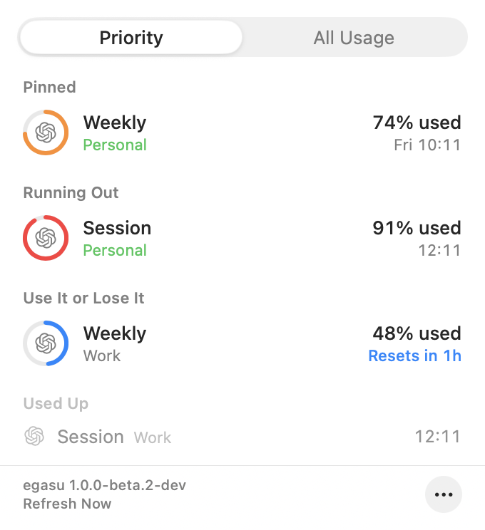
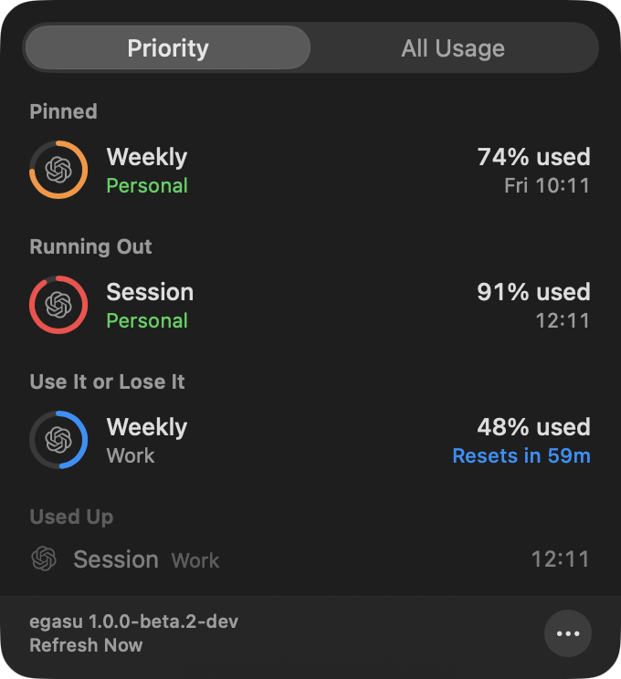
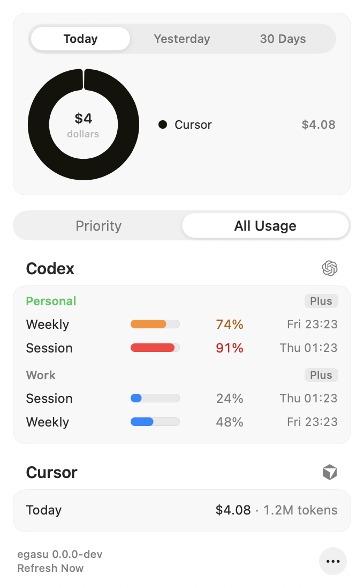
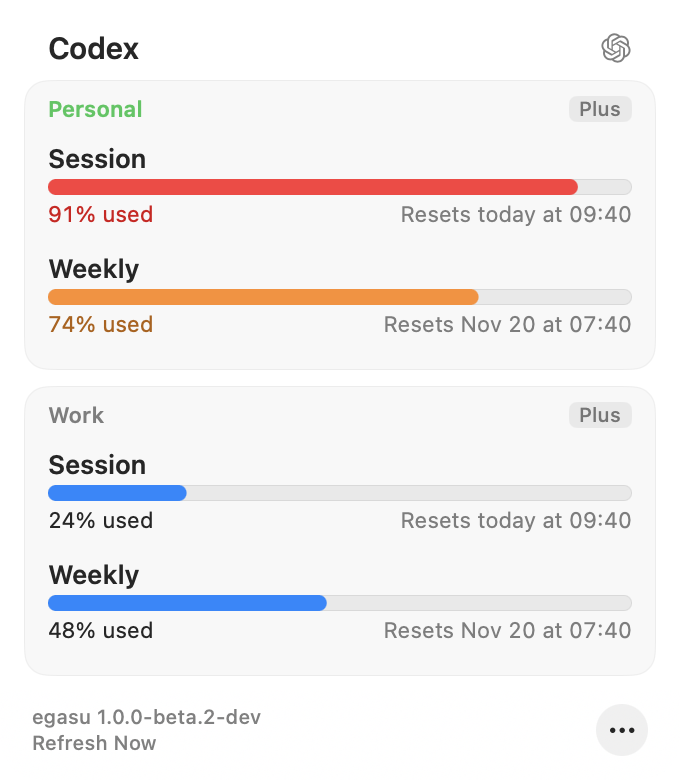
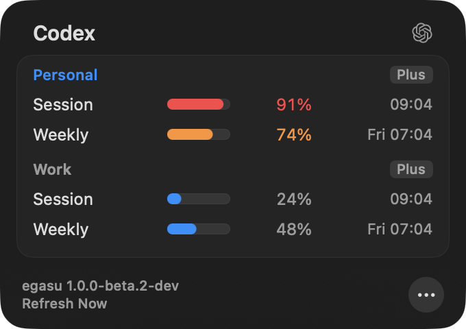
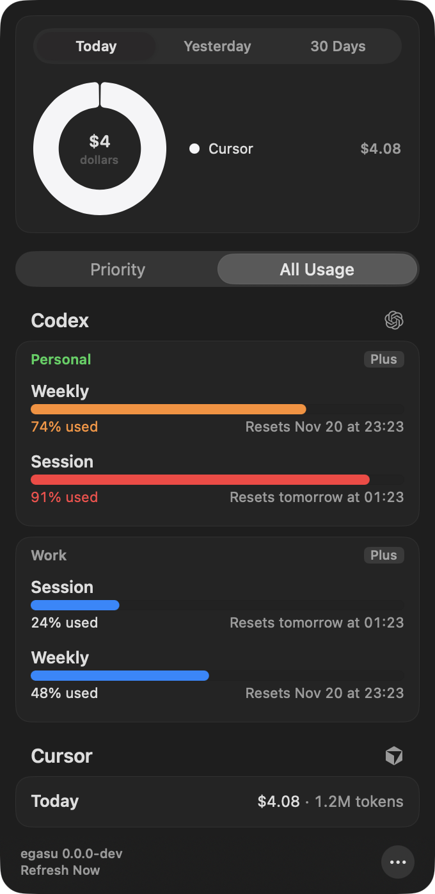
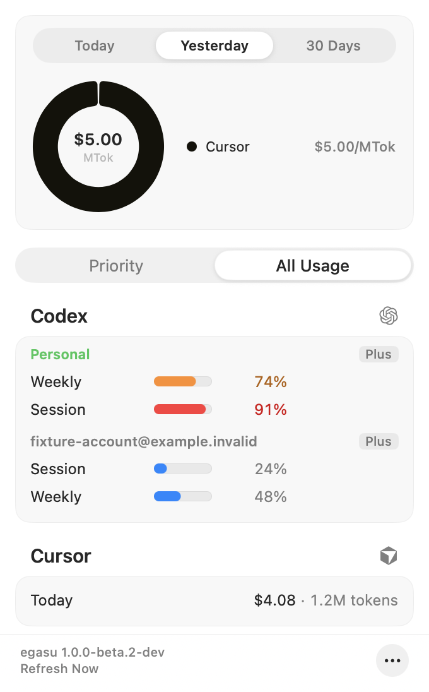
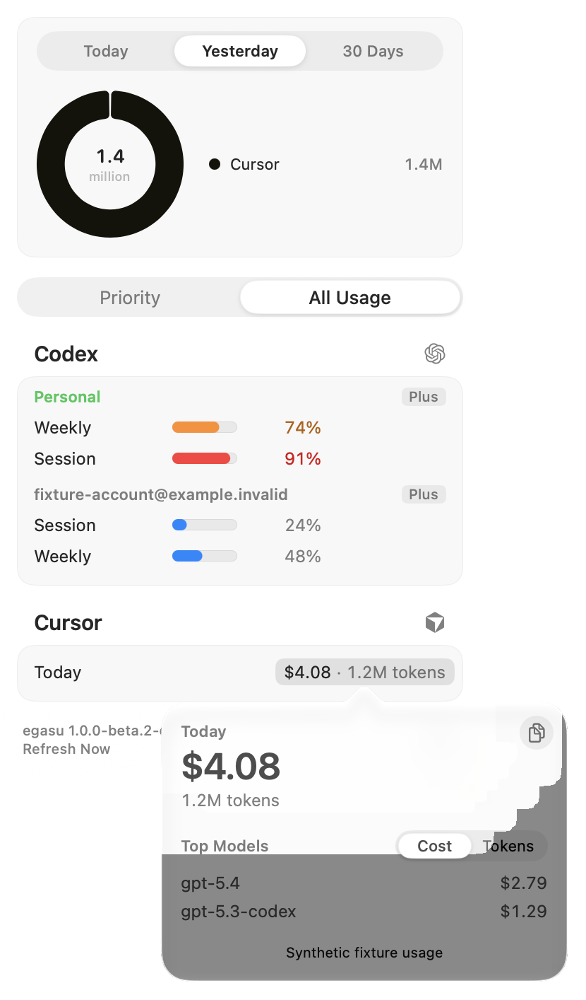

# 대시보드

메뉴 막대 아이콘에서 열리는 패널.
총 지출 요약 아래 **Priority**와 **All Usage** 탭 배치.
앱 시작 시 기본 Priority, 저장한 기본 탭이 있으면 해당 값 적용.
패널만 닫았다 열면 마지막 선택 탭 유지.

표시 언어는 [설정의 Language](/docs/settings.md#일반)에서 선택.
영어·한국어·일본어 지원이며 변경 후 앱 재실행 필요.
사용자가 지정한 계정명과 공급자·모델명은 원문 유지.
기존 캐시에 번역 정보가 없는 안내·차트 날짜는 새로고침 전까지 이전 문구 유지 가능.

## 첫 실행

새로 설치해도 egasu가 아는 모든 프로바이더가 켜지지는 않음.
Claude와 Codex로 시작한 뒤 Mac의 로컬 인증 정보·사용 흔적을 확인해 감지된 프로바이더 활성화.
기존 로그인, 저장된 API 키, 지원하는 환경 변수, 로컬 사용 이력 등 프로바이더별 감지 조건 적용.
이 감지 과정은 네트워크 요청 없이 수행.
아무것도 찾지 못하면 Claude/Codex 시작 세트 유지.
[Accounts](/docs/accounts.md)의 **Add New Account**에서 감지되지 않은 프로바이더도 직접 추가 가능.

전체 감지는 새 설치에서 수행.
업데이트는 기존 프로바이더의 켜기·끄기 설정 유지.
업데이트로 처음 추가된 프로바이더는 로컬 감지를 한 번 수행하고, 인증 정보나 사용 흔적이 감지된 경우 활성화.
전체 동작 흐름은 [활성화되는 프로바이더](/docs/provider-enablement.md) 참조.

## Priority

모든 계정의 한도를 한곳에 모아 지금 확인할 것만 표시.
지표마다 링 게이지, 지표 이름, 계정(같은 프로바이더 계정이 여럿일 때), "Out in …" 또는 "Resets in …" 표시.
계정명을 클릭하면 All Usage와 함께 로그인 이메일 표시로 전환.
새 터미널 세션용으로 선택한 Claude·Codex 계정은 별명과 이메일을 강조.

| 밝은 화면 | 어두운 화면 |
|---|---|
|  |  |

| 구역 | 내용 |
|---|---|
| Pinned | 고정한 지표. 소진 완료 후에도 저장된 계정·지표 순서 유지 |
| Running Out | 고정하지 않은 한도 중 남은 양이 Warning 기준 이하이거나 빠르게 소진 중(Burning Fast)인 항목, 급한 순 |
| Use It or Lose It | 고정하지 않은 한도 중 주기가 하루보다 길고, 초기화가 24시간 이내로 남았으며, 잔량을 정수 퍼센트로 반올림한 값이 50%를 넘는 항목. 달러 단위 한도 제외. |
| Needs Attention | 사용량을 가져오지 못한 계정 표시, **Fix**로 계정 상세 열기. VoiceOver에서 조회 실패 사유 안내. Privacy Mode에서는 일반 오류 안내 사용. Claude·Codex 계정의 Keychain 읽기 실패이면 **Fix**가 그 계정만 다시 조회하며 macOS Keychain 승인 창 표시 |
| Used Up | 고정하지 않은 한도 중 다 쓴 항목(흐리게) |

- [Use It or Lose It 알림](/docs/settings.md#알림) 설정은 알림 전송 여부만 제어.
- 한도 데이터를 받았고, 수신 대기·계정 경고·소진 임박이 없으면 **All Clear**("Nothing is running out.") 행 표시.
  고정한 경고 지표도 소진 임박 판정에 포함.
  경고 지표가 모두 고정된 경우 Pinned에만 표시하며 Running Out 구역과 All Clear는 숨김.
- 첫 조회 전인 계정은 자리 표시(**Waiting for Usage**).
- 한도를 보고하는 계정이 없으면 **No Reported Limits**와 **View All Usage** 버튼.
- 링의 채움 비율은 [Show Usage As](/docs/settings.md#사용량-표시)의 Used / Left 설정 적용.
  링 색은 남은 양과 [알림 기준](/docs/settings.md#알림)에 따라 결정.
  Warning 기준 이하는 주황, Critical 기준 이하는 빨강.
- Burning Fast: 지금 속도면 초기화 전에 다 쓸 한도.
  한 번 표시되면 예상 기말 사용량이 한도의 90% 이하로 내려올 때까지 유지.
- 행 우클릭으로 고정·해제(**Pin**/**Unpin**)와 숨기기(**Hide**).
- 푸터의 복사 버튼으로 Priority 목록을 공유 이미지로 복사.

### 고정

- 계정별 지표의 고정은 그 계정에만 적용.
  공통 지표의 고정은 프로바이더 단위로 공유.
- All Usage 지표 행 우클릭 → **Pin**, 또는 [계정 상세](/docs/accounts.md#계정-상세)의 핀 버튼.
- 숨긴 지표와 차트(Usage Trend)는 고정 불가.
  지표를 숨기면 해당 고정도 해제.
- 고정한 지표는 소진 임박·빠른 소진·초기화 전 사용·소진 완료 모두 Priority의 Pinned 구역에 유지.
  저장된 계정·지표 순서와 행 높이를 유지하고 다른 구역에는 중복 표시하지 않음.
  같은 자리에서 경고 색·소진 예상·초기화 시각 표시.
  모두 쓴 지표는 값 대신 **Used Up** 표시.
  고정을 해제하면 현재 상태에 맞는 구역으로 이동.
- 데이터 없는 한도·값 행은 고정 여부와 관계없이 숨김.
  고정 설정과 저장 순서는 유지하며, 데이터를 다시 받으면 원래 위치에 표시.
  이전 성공 값을 보존한 조회 실패에서는 해당 값과 고정 행 유지.
  조회 오류가 있으면 Needs Attention에 계정을 표시하고 All Clear는 숨김.
- 메뉴 막대에서 고정한 지표만 보려면 **Menu Bar Items → Pinned Only** 선택([메뉴 막대](/docs/menu-bar.md)).

## All Usage

[Settings → Appearance](/docs/settings.md#화면)의 **All Usage Layout**에서 표시 방식 선택.
기본값 **Minimal**은 프로바이더 카드 안에 계정별 한 줄 지표 묶음 표시.
**Cards**는 계정마다 독립 카드, 한도 지표는 제목·전체 폭 막대·사용량과 초기화 설명으로 표시.
Claude·Codex 등록 계정은 두 방식 모두 같은 프로바이더 섹션에 저장된 순서대로 표시.
표시 방식은 즉시 적용하며 앱 재실행 뒤에도 유지.
지표 표시·순서·Priority 고정과 사용량 데이터는 두 방식에서 공유.

| Minimal | Cards |
|---|---|
|  |  |
|  |  |

- 섹션 머리: 프로바이더 아이콘·이름, 공식 상태 페이지 장애 아이콘, 마우스를 올리면 섹션 복사 버튼.
- 계정 줄: 계정명(같은 프로바이더 계정이 여럿이거나 등록 계정일 때), 요금제 배지, 상태(새로 고침 중 표시, 문제 경고 삼각형 — 누르면 계정 상세 또는 Claude·Codex의 Keychain 읽기 실패 시 승인 창, 오래됨 시계).
  **계정명을 클릭하면** Priority와 All Usage에서 계정명과 로그인 이메일 전환(Claude·Codex 등록 계정, 이메일이 계정명과 다를 때).
  Privacy Mode가 켜져 있으면 캡처 감지와 관계없이 계정명·이메일 모두 흐림.
  공유 이미지의 계정명은 [공유](/docs/dashboard.md#공유)의 개인정보 규칙 적용.
- 지표 행: Minimal은 이름 · 막대 또는 값 · 초기화 시각, Cards의 한도는 여러 줄로 표시.

## 헤더 상태

조회 상태는 계정 줄에 표시 — 조회 중 진행 표시, 조회 문제의 경고 삼각형, 오래된 값의 시계 순서.
공식 상태 페이지의 장애 아이콘은 프로바이더 섹션 머리에 표시.
두 표시는 서로 다른 실패를 나타내므로 경고와 해골이 함께 나타날 수 있음.
VoiceOver에서 조회 오류·오래됨 상태의 안내 확인.
가격 미확정·메타데이터 오류 같은 집계 제약은 카드 경고로 표시하지 않음.
파일 읽기 실패로 확인할 수 없는 이력은 예외로 경고 표시.
새로 고침 대기와 실제 조회 중 상태를 구분하며 완료·취소 시 표시 해제.

활성화된 Claude, Codex, Cursor, Copilot 카드에서는 egasu가 각 프로바이더의 공식 상태 페이지에서 관련 컴포넌트를 확인.
컴포넌트가 성능 저하, 부분 장애, 중대/전체 장애를 보고하면 해골 표시.
예약된 유지보수, 관련 없는 컴포넌트 문제, 상태 확인을 지원하지 않는 프로바이더는 해골을 만들지 않음.
상태 피드 접근 실패·잘못된 응답·스키마 변경은 새 해골을 만들 수 없지만, 직전에 확인된 문제는 새로 고침 순회에서 마지막 성공 확인 후 15분 이상 경과를 확인하거나 정상 해석된 유지보수 전용 결과를 받을 때까지 유지.
서버 상태는 선택 계정이 아닌 프로바이더 패밀리 단위이며 메모리에만 유지.

## 총 지출

Priority·All Usage 탭 선택 위에 공통으로 표시하는 카드.
켜진 프로바이더 중 하나라도 기간별 비용·토큰을 추적하면(Claude, Codex, Cursor, Antigravity, Copilot, Devin, Grok, Kimi, Kiro, OpenCode, OpenRouter, Z.ai) 표시.
도넛 안쪽 원이나 오른쪽 범례 값을 클릭하면 **Cost**(비용) → **Cost/MTok** → **Tokens**(토큰) → **Cost** 순서로 전환.
중앙 클릭 영역은 글자 주변의 빈 공간을 포함한 원 전체이며, 바깥의 색상 링은 전환 대상에서 제외.
기본값은 Cost이며, 선택은 재시작 후에도 유지.
현재 단위의 데이터가 없으면 안내 문구를 클릭해 다음 단위로 전환.
캡슐형 전환 버튼으로 기간을 **Today**(오늘), **Yesterday**(어제), **30 Days**(30일) 사이에서 전환.
링, 중앙 합계, 순위 범례 모두 선택한 지표 적용.

- **Cost** — 각 세그먼트는 해당 프로바이더가 합산 달러에서 차지하는 비중(지출이 가장 큰 프로바이더부터).
- **Cost/MTok** — 각 세그먼트 크기는 해당 프로바이더의 백만 토큰당 달러 요율에 비례하며, 중앙은 지출과 토큰이 모두 있는 프로바이더들의 혼합 요율, 범례는 프로바이더별 자체 요율.
- **Tokens** — 각 세그먼트는 해당 프로바이더가 합산 토큰에서 차지하는 비중.

링 중앙은 항상 짧은 두 줄 — 위에 간결한 숫자, 아래에 작은 단위(`$533` / `dollars`, `12.4` / `million`, `$1.37` / `MTok`) — 덕분에 Cost/MTok와 큰 합계도 링 안쪽에서 읽기 쉬움.
Cost 모드는 숫자에 `$` 유지.
중앙에 마우스를 올리면 전체 자릿수의 수치를 한 줄로 확인.
선택한 지표에 로컬 추정치가 포함되면 추정 안내 추가.
Cost는 비용, Tokens는 토큰, Cost/MTok은 비용·토큰 양쪽의 추정 여부 반영.
프로바이더마다 브랜드에서 가져온 고정 색을 유지하고(Claude의 테라코타, OpenAI의 초록 등), 비중이 아주 작아도 링에 보이는 조각은 남김.
선택한 지표에 값이 없는 프로바이더는 아예 등장하지 않음 — 0으로 계산하는 일 없음.
[Kimi](/docs/providers/kimi.md#상단-비용토큰-통계)는 지원하는 로컬 기록의 Tokens를 포함하며, 선택 기간의 모든 집계 대상 요청에서 모델·캐시 요금을 확인할 때만 Cost·Cost/MTok 표시.
Kimi의 모델 라우팅·캐시 과금 구분이 불명확한 기간은 토큰만 유지하고 비용 생략.
(Accounts에서 지출 행을 숨겨 두었어도 활성화된 프로바이더는 합계에 포함하지만, 잔액·구매 크레딧·기간이 다른 사용액은 합산하지 않음.)
OpenRouter는 관리 키로 조회한 계정 전체의 기간별 비용·토큰을 합계에 포함.
비용만 있는 기간은 Cost에만 포함하며, 일반 키의 키별 기간 사용액은 상단 통계에서 제외.
집계 범위와 연결 방법은 [OpenRouter](/docs/providers/openrouter.md#상단-비용토큰-통계) 참조.
Z.ai는 개인 GLM Coding Plan의 일별 토큰을 Tokens에 포함.
모델별 토큰 분해와 정확한 가격이 확인된 기간은 같은 상세 응답으로 Cost·Cost/MTok도 추정.
불완전한 기간은 비용 없이 기존 토큰만 유지하며, 범위와 연결 방법은 [Z.ai](/docs/providers/zai.md) 참조.
Antigravity는 로컬 대화 이력의 모델별 토큰과 공통 가격으로 계산한 추정 비용을 같은 링에 반영.
가격을 확인할 수 없는 모델도 토큰은 합계에 유지하고, 불완전한 기간 비용은 생략.
해당 Mac의 패밀리 합계이며 현재 로그인 계정별 비용으로 분해하지 않음.
할당량 조회에 실패해도 유효한 로컬 이력은 합계에 유지하고 프로바이더에 경고 표시.
Copilot은 로컬 CLI 요청 기록의 날짜별 토큰·크레딧 환산 비용을 합계에 포함.
Copilot의 월간 할당량과 조직 전체 비용은 합산 대상에서 제외.
CLI 기록이 없는 기간은 값 미표시.
집계 범위는 [Copilot](/docs/providers/copilot.md#상단-비용토큰-통계) 참조.
Devin은 로컬 CLI 요청의 토큰과 공통 모델 가격으로 추정한 비용을 합계에 반영.
모델 가격을 확인할 수 없는 요청이 있는 기간은 토큰만 표시.
할당량 조회가 실패해도 새로 읽은 로컬 통계는 갱신하며 기존 한도·요금제·조회 시각은 보존.
집계 범위는 [Devin](/docs/providers/devin.md#상단-통계-지원-범위) 참조.
Kiro는 로컬 CLI V3의 턴별 크레딧 환산 비용과 대화 길이 기반 토큰 추정치를 같은 통계에 반영.
실제 청구액이나 측정 토큰 수가 아니며, 응답 이력이 없는 유료 턴이 섞인 기간은 Cost만 표시.
계산 기준과 범위는 [Kiro](/docs/providers/kiro.md#상단-통계-지원-범위) 참조.
활성 지표에 보여 줄 값이 없는 기간에는 카드를 숨기지 않고 간결한 빈 상태 표시.
카드가 아예 필요 없다면?
[설정](/docs/settings.md) 상단의 **Show Total Spend**(총 지출 표시)로 끄기.

## 행

### 한도가 있는 지표

세션, 주간, 상한이 있는 크레딧은 막대로 표시.

- 막대 색은 남은 양 기준(기본 Warning 30%·Critical 10%): 평소 파랑, Warning 기준 이하 주황, Critical 기준 이하 빨강.
- 값은 `52%` 같은 남은 양 또는 사용량.
  **값을 클릭하면** 모든 곳에서 Used와 Left 전환.
- 초기화 칸은 `3h`·`18:38` 같은 짧은 시각.
  **클릭하면** 모든 곳에서 남은 시간과 정확한 시각 전환.
  남은 시간이 로컬 달력 기준 1년 이상이면 연·개월, 한 달 이상이면 개월·일, 그보다 짧으면 일·시간 또는 시간·분으로 표시.
  영어는 분 `m`과 개월 `mo`를 구분(`3mo 12d`, `1y 2mo`).
  한국어·일본어는 해당 언어의 단위 사용(`3개월 12일`, `1年 2か月`).
  큰 두 단위까지만 표시하며 끝 단위가 0이면 생략(`4d`, `1mo`, `1y`).
  월말·윤일·서머타임을 포함한 연·개월 경계는 사용자 달력·시간대 기준, 한 달 미만은 실제 남은 시간 기준.
  정확한 시각은 사용자 시간대와 Settings의 Auto·12h·24h 선택 유지.
  초기화권 만료처럼 다른 곳의 남은 시간에도 같은 표기 적용.
- 막대에 마우스를 올리면 초기화 시점 속도 예측(`~35% left at reset`, `~12% over limit at reset` 등).
- **Always Show Pacing**을 켜면([Settings](/docs/settings.md#사용량-표시)) 막대에 균등 속도 눈금 표시.
  유효한 초기화 시각·주기가 필요하며, 기간 시작 직후와 미시작·소진 상태는 제외.
- **Soft Limit**을 켜면 지원 대상 5시간 또는 주간 막대에 직접 입력한 1%–100% 임계값의 얇은 안내선 표시 — 저장된 임계값이 없으면 기본값 90%.
  프로바이더의 강제 한도와 별개인 사용자 기준선이며, 채움·사용량·속도 판정·초기화에는 영향 없음.
  Used와 Left에서 위치만 반전 — 95% used 임계값은 반대 화면의 5% left 위치.
  도달 여부는 막대 hover 문구에 표시하며 취소 완료 증거는 아님.
  활성화·연결·취소 상태는 [Soft Limit 설정](/docs/settings.md#soft-limit) 참조.

### Codex Reset Watch

할당량 동작 없이 같은 막대 형태로 전역 리셋 예측 표시.
추가 계정 섹션에는 표시하지 않고 공유 홈 계정 섹션에만 표시.
API에 리셋 예정 정보가 있으면 예측 확률 **99% chance**와 `Scheduled {날짜} at {시각}` 또는 `Scheduled in …` 표시.
99%는 API 확률이 아닌 egasu의 고정 예측값.
리셋 예정 정보에 시각이 없으면 **Reset time unknown** 표시.
예정 시각이 지나도 리셋 완료로 처리하지 않음.
시각이 있는 예정 정보는 예정 시각 이후 2시간 동안 유지한 뒤 만료.
조회 지연·실패와 관계없이 대시보드와 메뉴 막대에 적용.
조회 사이에 만료되면 새 예측 정보를 받기 전까지 **0% chance** 표시.
조회 실패 상태이면 사용 불가 안내 표시.
그 외에는 API의 활성 watch 확률과 `By …` 또는 `Within …` 기한으로 예측 표시.
카운트다운은 기한까지 5분 이하가 남으면 활성 watch에 **Reset expected soon**, 리셋 예정 정보에 **Scheduled soon** 표시.
리셋 예정 정보는 예정 시각이 지난 뒤에도 2시간 유예 기간 동안 **Scheduled soon** 유지.
예측 시각을 클릭하면 세션·주간 타이머와 함께 카운트다운과 정확한 시각 전환.
Settings의 **Reset Times**와 같은 전역 설정 사용.
예측 확률은 Used/Left, 속도, 할당량 알림 설정의 영향을 받지 않음.
활성 watch로 예측할 때는 커뮤니티 투표율(전체 응답 중 **Yes** 비율)을 예측 확률과 별도로 표시.
집계가 없거나 조회 실패 시 예측을 유지하면서 **Vote share unavailable** 표시.
예측 시각은 사용량 재설정 날짜와 같은 `날짜 at 시각` 형식과 12/24시간 설정 사용.
정확한 시각에 마우스를 올리면 **Resets in …** 또는 **Resets soon**, 카운트다운에 올리면 정확한 예측 시각 표시.
시각 미상·조회 실패·만료된 예측은 시각 전환과 시각 툴팁 없음.
막대 색은 40% 미만 회색, 40–59% 파랑, 60–69% 주황, 70% 이상 빨강.
확률이 높을수록 예상 재설정 전에 남은 토큰을 먼저 쓰라는 경고 강화.
조회 실패 시 시각 대신 사용 불가 또는 캐시 예측 안내 표시.
유효한 리셋 예정 정보가 없고 조회 성공 후 활성 신호가 없거나 확률이 없거나 예측이 만료되면 기한·커뮤니티 투표율 없이 **0% chance** 표시.
첫 조회 전에는 활성 지표마다 대기 행 표시.
예측 만료 시 행 타이머 중단.

### 한도가 없는 지표

일일 지출·잔액은 값 칸에 `$4.08`·`1.2M` 같은 값으로 표시.
Today / Yesterday / Last 30 Days 행은 비용과 토큰을 함께 묶어 표시(`$4.08 · 1.2M tokens`).
계정 상세에서 켜고 끌 수 있음.
모델별 비용 내역은 센트 단위로 반올림하되, 소수부를 표현할 수 없는 큰 유한 금액은 원래 값 유지.
표시 반올림 때문에 비용이 무한대로 바뀌거나 스냅샷 저장이 실패하지 않도록 처리.
사용 가능한 스냅샷에 기간 행이 빠졌으면 해당 지표가 지원하는 비용·토큰 항목에 0 표시.
스냅샷이 없거나 오류 행만 받으면 누락된 기간 행을 **No data**로 표시.
첫 응답을 기다리는 동안에는 로딩 표시.
데이터 없는 한도·값 행은 숨기고, Usage Trend 차트 행은 "No data"로 유지.
큰 숫자는 축약 표시(`$2.06K`, `1.5B`).
값에 마우스를 올리면 정확한 수치와 로컬 추정치 같은 출처 안내 확인.

### 사용 내역

Claude, Codex, Cursor, Grok, OpenCode 기간 행에서 사용 내역을 열 수 있는 값에 마우스를 올리면 강조 표시.
잠시 올려 두거나 클릭하면 해당 기간의 사용 내역 패널 열기.
클릭해 연 상세는 포인터가 떠나도 유지.
대시보드를 닫거나 해당 모델 내역이 바뀌면 상세 닫힘.

- 요약: 기간 비용(큰 글자)과 토큰.
- **Top Models**: 상위 5개 모델 + 나머지를 합친 **Other**.
  가격을 아는 모델이 있으면 **Cost**·**Tokens** 전환, 그 외 **Tokens** 표시.
  기본 선택은 **Cost**이며 사용자 선택은 앱 전체에 유지.
  묶인 모델 행에 마우스를 올리면 원본 변형별 이름·비용·토큰 표시.
  가격을 모르는 변형의 비용은 `—`로 표시하고 토큰은 유지.
  모델별 비중(%)은 목록과 툴팁 모두 표시하지 않음.
- 출처 문구(로컬 추정, iCloud 병합 등).
- 오른쪽 위 복사 버튼: 같은 내용을 공유 이미지로 클립보드에 복사(프로바이더 이름만, 계정명 없음).
- 비용·토큰이 모두 0이고 모델 내역도 없으면 값만 표시하고 상세 팝오버·클릭 강조 생략.
  비용이 0이거나 가격을 몰라도 토큰 사용 내역이 있으면 상세 유지.
- 합계는 있는데 모델별 내역이 없으면 합계 패널 표시.
  제목 옆에 합계를 읽은 시각(**Saved** …).
  새로 고침 중이면 **Loading Breakdown…**, 그 밖에는 **Breakdown Unavailable**과 사유.
  사유는 계정 공지 → 오래됨 안내 → 새로 고침 안내 순으로 하나만 표시.

집계 기준일이 지난 상세 패널과 공유 이미지는 **Today**·**Yesterday** 대신 해당 날짜 표시.
**Last 30 Days**는 **30 Days Ending {날짜}**로 표시.
집계 당시의 날짜·시간대를 기준으로 판정하며 합계는 그대로 유지.
한도 조회나 화면 갱신 시각으로 집계 기준일을 바꾸지 않음.
집계 기준일이 없는 이전 캐시는 기존 제목을 유지하고, 다음 정상 집계부터 날짜 보정 적용.

Cursor는 추론 강도별 내보내기 슬러그(예: `claude-opus-4-8-thinking-max`)를 기본 모델 아래로 묶음.
집계에서 기간 비용 비중이 5% 미만인 모델은 **Other**로 묶음.
전체 비용을 확인할 수 없거나 비용 합계가 0이면 토큰 비중 적용.
가격을 확인할 수 없는 모델도 사용 내역·행 합계·Usage Trend의 토큰에 포함.
해당 기간의 총비용과 Cost/MTok은 생략하고, 가격이 확인된 모델의 개별 비용은 유지.
Cost 보기에서 비용을 모르는 모델은 끝에 `—`로 표시하며, 그런 모델이 섞인 **Other**도 비용 미표시([가격](/docs/pricing.md) 참조).

### Usage Trend

오늘과 이전 30일의 토큰 사용량을 담은 막대 차트(Claude, Codex, Cursor, Grok, OpenCode).
총 31개 날짜를 표시하며 기록이 없는 날짜는 0으로 채움.
기간 전체에 토큰 사용 기록이 없으면 차트 대신 **No data** 표시.
하루에 막대 하나, 해당 프로바이더의 지출 행과 같은 소스(Claude, Codex, Grok, OpenCode는 로컬 로그, Cursor는 사용량 내보내기).
**마우스를 올리면** 최고 사용일, 날짜 범위, 소스 확인.
기본값은 켜기이며, 다른 지표처럼 계정 상세에서 끄거나 순서 변경 가능.
고정 불가 — Priority 게이지와 메뉴 막대는 차트가 아니라 단일 값을 보여 주기 때문.

### 동기화와 갱신

[iCloud 동기화](/docs/icloud-sync.md)를 켜면 기기 로컬 프로바이더의 지출 행, 추이, 모델별 내역을 동기화된 모든 Mac의 데이터로 재구성.
가격 미확정 토큰과 기간 비용 생략 규칙도 병합 후 유지.
Cursor는 계정 전체 기준의 내보내기 데이터를 사용하므로 Mac 간 합산 대상에서 제외.
할당량, 요금제, 잔액, 프로바이더 오류는 항상 이 Mac의 새로 고침 기준.

초기화 시각이나 알려진 Reset Watch 시각이 있는 행은 30초마다 다시 렌더링되어 네트워크 새로 고침 사이에도 카운트다운·시각 툴팁·속도·예측 만료가 최신 상태 유지.
이 UI 갱신은 네트워크 요청을 만들지 않음.
Reset Watch 소스 조회는 별도 15분 주기로 실행.
수동 Refresh(⌘R)도 활성 Reset Watch의 예측·해당하는 커뮤니티 투표율을 사용량과 함께 재검증하되 오류 후 재시도 대기는 유지.

## 계정 카드

Accounts 또는 대시보드에서 시작한 전환과 해당 계정의 후속 처리가 끝나면 다음 계정 전환 가능.
전환 중에는 계정 전환 버튼, Claude·Codex 계정의 수동 새로 고침, 전체 새로 고침(**Refresh Now**·⌘R) 차단.

프로바이더에 등록 계정이 있으면 All Usage는 해당 계정만 사용.
현재 공유 홈(`~/.claude`, `~/.codex`)의 로그인으로 조회하는 줄도 등록 계정명 사용.
Codex 공유 홈 로그인이 다른 등록 계정과 일치하면 해당 계정의 스냅샷 대신 실시간 줄 사용.
이 표시 매핑은 Accounts 선택과 저장 인증을 변경하지 않음.
Claude는 [터미널 재인증 동작](/docs/providers/claude.md)에 따라 검증된 공유 홈 로그인을 선택 계정명에 반영.
미등록 공유 홈 로그인은 별도 계정 줄로 추가하지 않음.
등록 계정이 없는 프로바이더는 기본 사용량 줄 유지.
저장 인증이 없는 등록 계정은 Accounts에 남지만 사용량을 제공할 수 있을 때까지 대시보드 줄을 만들지 않음.
비활성 계정은 egasu 전용 Keychain에 저장한 인증으로 계정별 사용량 API 조회.
두 등록 계정이 같은 프로바이더 신원을 증명해도 각각의 계정명과 줄 유지.

한도·Rate Limit Resets 등 계정별 지표의 표시·순서·고정은 계정마다 저장.
공유 홈 카드와 추가 계정 카드가 바뀌어도 같은 등록 계정의 숨김·순서 유지.
Claude·Codex 로컬 이력과 Codex Reset Watch는 프로바이더 공통 지표이며 공유 홈 계정에만 표시.
공통 지표의 표시·순서·고정은 같은 프로바이더의 계정에서 공유.
새 계정은 기본 지표로 시작하며 저장된 계정은 숨김·순서 유지.
표시할 지표가 있는 계정은 첫 조회 실패로 모든 행이 숨겨져도 계정 경고 유지.
공통 지표를 숨긴 추가 계정의 마지막 행이 사라지면 해당 계정 줄도 숨김.
메뉴 막대는 [표시 기준](/docs/menu-bar.md#표시-항목)에 따라 모든 표시 계정에서 선택.
공유 이미지는 현재 표시 중인 계정·지표 순서와 All Usage 레이아웃 사용.

## 우클릭 메뉴

| 위치 | 항목 |
|---|---|
| 지표 행 | **Pin**/**Unpin**(고정 가능한 지표만), **Hide**, 아래 계정 메뉴 |
| 계정 줄 | 계정 상태(문제가 있을 때), **Use {Provider}: {name}**(새 터미널 세션 계정이 아닐 때), **Refresh**, **Rename**(Claude·Codex 등록 계정), **Edit Account…** |
| 섹션 머리 | **Refresh**, **Manage Accounts…**, 프로바이더 페이지 링크(Status, Console 등) |

- Priority 행 우클릭은 **Pin**/**Unpin**과 **Hide**만 표시.
- **Hide**는 계정별 지표를 그 계정에서, 공통 지표를 프로바이더 전체에서 숨김.
  숨긴 지표는 All Usage·Priority·메뉴 막대에서 제외하고 해당 고정 해제.
  해당 지표의 할당량 알림도 제외.
  Codex Reset Watch는 지표를 숨겨도 별도 알림 설정에 따라 통지.
  다시 표시하려면 **⌘Z** 또는 [계정 상세](/docs/accounts.md#계정-상세)의 표시 스위치.
- **Rename**은 계정 줄의 이름 자리에서 바로 편집 — Return 저장, Esc 취소.
  Privacy Mode가 켜져 있으면 대시보드의 Rename은 비활성화하며, 이름 편집은 Accounts의 계정 상세에서 가능.
  이름을 비우고 저장하면 별명을 지우고 로그인 이메일을 이름으로 사용(이름 규칙은 [계정 상세](/docs/accounts.md#계정-상세) 참조).
  계정명 클릭은 계속 계정명과 로그인 이메일 전환.
- **Use {Provider}: {name}**은 확인 후 Accounts와 같은 방식으로 저장 로그인을 교체하며, 새 터미널 세션이 해당 계정 사용.
  Privacy Mode가 켜져 있으면 이 메뉴와 전환 확인창의 계정명 대신 마스킹한 로그인 이메일 표시.
  이메일이 없으면 **Account(계정)** 표시.
- **Edit Account…**와 **Manage Accounts…**는 [Accounts](/docs/accounts.md) 열기.

## 공유

카드를 브랜드 PNG로 클립보드에 복사해 채팅·문서에 붙여넣기.

- 섹션 머리 복사 버튼: 프로바이더 섹션 전체.
- All Usage 공유 이미지는 선택한 Minimal / Cards 레이아웃 적용.
- Priority 탭 푸터 복사 버튼: Priority 목록.
- 링이 표시될 때 총 지출 카드를 우클릭하고 **Share Screenshot**으로 현재 보기 복사.
- 사용 내역 패널 복사 버튼: 해당 기간 사용 내역.
- 이미지 하단 띠: egasu 마크와 "Monitor Your AI Subscriptions".
- 라이트/다크 설정 적용.
- All Usage 섹션 이미지에서는 헤더 상태 표시와 마지막 초기화권 사용 결과를 확인하는 동안만 남겨 둔 행을 제외.
- 계정명이 포함되는 이미지에는 [공유 개인정보 규칙](/docs/privacy.md#share-screenshot) 적용.

## 푸터

패널 하단에 고정된 막대.
왼쪽에는 앱 버전과 다음 일반 갱신까지 남은 시간을 **Next update in …** 한 줄로 표시.
조회 중에는 **Updating…**, 활성 프로바이더가 없거나 일정이 아직 정해지지 않았으면 **Refresh Now** 표시.
클릭 또는 **⌘R**로 즉시 새로 고침하되 Claude의 요청 제한 대기는 유지.
오른쪽 ⋯ 메뉴: **Accounts**, **Settings**, **Check for Updates…**, **Report an Issue…**, **About egasu**, **Quit egasu**.
**About egasu**에는 포크 관리자 `kimchanhyung98`와 `kimchanhyung98/egasu` 저장소 링크 표시.

## 순서 바꾸기

프로바이더·계정·지표의 표시와 순서는 [Accounts](/docs/accounts.md#계정-상세)에서 관리.
새 설치의 지표는 모두 기본 켜짐이며 기존 숨김·순서 유지.
저장된 On Demand 지표는 일반 지표 뒤에 합치고 각 구역의 상대 순서는 유지.

- 지표 행 드래그: 계정별 지표는 해당 계정의 순서, 공통 지표는 프로바이더 공통 순서.
- 계정 줄 드래그: 같은 프로바이더 안 등록 계정 순서.
- 섹션 머리 드래그: 계정 묶음 전체의 프로바이더 순서.
- Force Touch 트랙패드에서는 새 위치에 맞춰질 때 가벼운 진동.
- **⌘Z**로 지표 숨김·표시, 지표·프로바이더 순서와 Priority 고정 실행 취소.
  계정 순서는 실행 취소 대상에서 제외.
  실행 취소 이력은 앱 재실행 시 초기화.

## 키보드

| 키 | 동작 |
|---|---|
| Return | 대시보드에서는 Accounts 열기, 계정 상세에서는 목록으로, 목록이나 설정에서는 대시보드로 |
| Esc | 계정 상세 → Accounts 목록 → 대시보드 순서로 복귀, 대시보드에서는 팝오버 닫기 |
| ⌘Z | 마지막 사용자 지정 변경 실행 취소(앱 전체, 반복하면 계속 되돌아감) |
| ⌘R | 대시보드나 설정에서 즉시 새로 고침(캐시 건너뜀) |
| ⌘, | 설정 열기/닫기(팝오버 안) |

전역 단축키(설정에서 기록)로 어디서든 팝오버 토글.

## 닫기

팝오버를 닫으면 탐색 상태 초기화 — 스크롤 위치는 맨 위로 복귀하고 Accounts / Settings는 닫힘.
