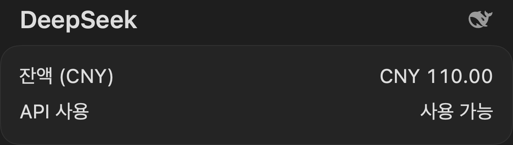

# DeepSeek

DeepSeek API 계정의 잔액과 API 호출 가능 여부 표시.

## 계정 등록

1. Accounts → Add New Account에서 DeepSeek 선택.
2. [DeepSeek의 API 키 관리 페이지](https://platform.deepseek.com/api_keys)에서 발급한 키를 입력하고 **Add Account** 클릭.

앱에서 저장한 키는 이 Mac의 앱 전용 설정 파일(`deepseek.json`, 권한 `0600`)에 보관.
저장한 키가 없으면 `DEEPSEEK_API_KEY` 환경 변수 사용.
계정 제거 시 앱에 저장한 키를 삭제.

## 잔액

새로고침할 때 [잔액 API](https://api-docs.deepseek.com/api/get-user-balance/)에서 조회.
서버가 보고한 USD와 CNY 총잔액을 각각 표시.
각 금액에 포인터를 올리면 해당 통화의 충전액과 지급액 확인.
카드, 메뉴 막대와 [로컬 Usage API](/docs/local-http-api.md#레거시-usage-응답-형식)는 잔액의 소수점 이하 자릿수를 서버 표기대로 유지.
명시한 잔액 0은 그대로 표시하고, 응답에 없는 통화는 카드에서 생략.
잔액 목록이 비어 있으면 API 사용 가능 여부만 표시.

**API 사용 가능 여부**는 서버가 보고한 잔액 충분 여부.
계정 키가 거부되면 Accounts에서 교체.

앱과 CLI는 조회에 사용한 키의 단방향 지문을 비교해 현재 키에 해당하는 잔액만 표시.
같은 키로 조회에 실패하면 마지막 정상 잔액과 오류를 표시.
앱에서 키를 교체하거나 제거하면 이전 잔액 숨김.
앱 밖에서 키를 바꾸면 다음 조회에서 변경을 확인.
