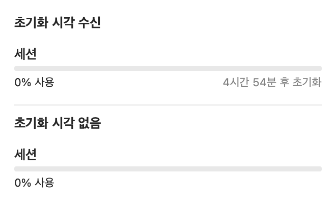

# Kimi

Kimi Code CLI의 OAuth 로그인 또는 API 키로 코딩 할당량 추적.
egasu 안에서 별도 로그인이나 API 키 재입력 불필요.

## 추적 항목

| 지표 | 의미 |
|---|---|
| Session | 5시간 순환 기간의 사용량과 초기화 시각 |
| Weekly | 7일 기간의 사용량과 초기화 시각 |
| Total Usage | Kimi·Kimi Code가 공유하는 월간 총한도의 사용 비율과 초기화 시각 |
| Extra Usage | 이번 주기의 추가 사용 지출. 지출 상한을 켠 경우 사용액·상한 함께 표시 |
| Extra Balance | 추가 사용량 지갑의 남은 충전 잔액 |

[공식 CLI의 할당량 파서](https://github.com/MoonshotAI/kimi-code/blob/1364ab4741a07fb24a73634ffeea5e1503599068/packages/oauth/src/managed-usage.ts)의 `usages.limit_5h`·`limit_7d`·`limit_month_total`에서 `used_ratio`와 `reset_time` 사용.
구형 응답의 `limits`·`usage`도 지원.
월간 한도만 있는 응답도 Total Usage로 표시.
`limit_month_code`는 [공식 사용량 표시 코드](https://github.com/MoonshotAI/kimi-code/blob/1364ab4741a07fb24a73634ffeea5e1503599068/apps/kimi-code/src/utils/usage/usage-format.ts)와 같이 월간 총사용량에 포함된 Code 사용분.
같은 사용분의 중복 표시를 피하기 위해 독립 지표·설정 스위치·API 리소스로 노출하지 않음.
총사용량은 `limit_month_total`만 사용하며 Code 사용분을 더하거나 총사용량 대신 사용하지 않음.
월간 주기는 구독 갱신 주기이므로 시작일 없이 30일로 추정하거나 페이스를 계산하지 않음.
초기화 시각은 API의 `reset_time` 그대로 사용.
Session은 사용량이 0%여도 표시 설정에 따라 남은 시간 또는 서버의 초기화 시각 표시.
초기화 시각이 없거나 읽을 수 없으면 사용량만 표시.
표시 순서는 Session·Weekly·Total Usage·Extra Usage·Extra Balance이며 새 지표는 기본 켜짐.
기존 표시·숨김·순서 설정 우선 유지.
`goods_version`으로 요금제 이름을 추정하지 않음.
신규 요금제는 주간 한도가 없지만 Kimi·Kimi Code가 공유하는 월간 총한도는 유지.
월간 총한도 소진 시 초기화나 업그레이드 전까지 구독 사용 중단 가능.
Extra Usage를 활성화하고 사용 가능한 잔액이 있으면 추가 사용 가능.
조건과 확인 경로는 [공식 멤버십 안내](https://www.kimi.ai/help/kimi-code/benefits) 참조.

글로벌 신규 유료 요금제는 Plus·Pro·Max·Ultra이며, 중국에는 Kimi Code를 포함하지 않는 Go도 존재.
지역별 가격과 연간 결제액은 [구독 요금제](/docs/pricing.md#구독-요금제) 참조.
기존 구독은 이름·갱신·한도 유지 가능하므로, 이전 멤버십 등급의 Adagio·Moderato·Allegretto·Allegro·Vivace 매핑 유지.
새 이름을 담은 등급은 그 이름을 표시하고, `goods_version`만으로 기존 등급을 새 요금제로 치환하지 않음.
현재 형식의 `usages` 응답에 `limit_7d`가 없으면 Weekly 행 미생성.
레거시 응답의 `usage`가 있으면 Weekly 행 표시.
알 수 없는 등급도 읽기 쉬운 형태로 유지.

## 추가 사용량

추가 사용량 응답의 `boosterWallet`·`booster_wallet` 지원.
`balance.type`이 `BOOSTER`인 지갑의 `amountLeft`를 100,000,000으로 나눠 통화 단위 잔액으로 변환.
`monthlyUsed.priceInCents`·`monthlyChargeLimit.priceInCents`는 100으로 나눠 지출·상한으로 변환.
`monthlyChargeLimitEnabled`가 참일 때만 지출 상한 적용하며, 이 필드는 추가 사용량 활성화 스위치가 아님.
상한이 없으면 지출액만 표시하며, 명시적 0 상한은 무제한으로 바꾸지 않음.
USD 지출은 양수 상한이 켜진 경우 금액·상한 게이지로 표시.
명시적 0 상한은 금액·상한 문구로 표시하고, CNY 등 다른 통화는 통화 코드를 붙인 금액으로 표시.
다른 통화의 금액을 USD로 환산하거나 USD API 지표로 내보내지 않음.
추가 사용량의 지갑 만료일을 월간 지출 초기화일로 사용하지 않음.
자세한 과금·상한 규칙은 [글로벌 추가 사용량](https://www.kimi.ai/help/membership/membership-extra-usage)·[중국 추가 사용량](https://www.kimi.com/en/help/membership/membership-extra-usage) 참조.

`BOOSTER` 지갑이 있으면 잔액·지출 0도 표시.
지갑에서 생략되거나 `null`인 금액은 0으로 처리.
통화가 없거나 `null`이면 같은 지갑에 명시된 다른 금액의 통화 사용.
두 금액 모두 통화가 없으면 USD 사용.
상한 활성화 값이 없거나 `null`이면 상한 미적용.
지갑이나 잔액 객체가 없거나 `null`이면 추가 사용량 지표 미생성.
숫자로 해석할 수 없는 금액 등 잘못된 형식은 응답 오류로 표시.

## 구독 타이머

적용 한도·실행 조건·CLI 로그인 요건은 [구독 타이머 자동 시작](/docs/refreshing.md#구독-타이머-자동-시작) 참조.
사용량 0%에서도 서버 초기화 시각이 재확인 사이에 고정되어 있으면 이미 진행 중인 기간으로 판단하고 메시지 미전송.
자동 전송은 환경 변수 인증을 지원하는 Node.js Kimi Code CLI 2.0.1 이상 지원.
[공식 명령 규약](https://moonshotai.github.io/kimi-code/en/reference/kimi-command.html)의 `--prompt`와 [Markdown agent 형식](https://moonshotai.github.io/kimi-code/en/customization/agents)의 빈 도구 목록 사용.
Python CLI 1.x는 실행 전에 호환 오류로 차단.
월간 총한도가 소진된 계정은 자동 메시지 전송 대상에서 제외.
추가 사용량의 지출 상한은 구독 한도 소진으로 취급하지 않음.
확인된 OAuth 계정과 같은 Code 서버 사용.
API 키만으로 계정 신원을 추정해 자동 메시지를 보내지 않음.

## 상단 비용·토큰 통계

Kimi Code CLI의 로컬 사용 기록으로 Today·Yesterday·Last 30 Days의 Tokens·Cost·Cost/MTok 집계.
현재 Mac의 로그 범위이며 계정 전체 사용량이나 Kimi 구독 청구 내역을 뜻하지 않음.
사용량 게시 전에 요청에 사용한 로그인이 유지되는지 확인.
세션 한도만 있는 응답도 같은 검사 적용.
원격 할당량 조회 실패 시 기존 마지막 정상값 유지 및 새 토큰 집계 중단.
이 경우 로컬 이력 수집은 실행하지 않으며 이력 읽기 실패 경고를 추가하지 않음.
할당량 조회가 회복되면 로컬 토큰도 다시 집계.
일부 이력 파일만 실패하면 확인된 사용량으로 갱신하고 경고 표시.
사용할 수 있는 기록 없이 이력 전체가 실패하면 같은 날짜의 마지막 정상 통계와 원래 통계 조회 시각 유지.
정상적으로 확인한 빈 이력은 빈 통계로 반영하며 전날 Today 값을 새 날짜에 재사용하지 않음.
Cost·Cost/MTok는 기록된 모델과 토큰을 공통 API 요율에 적용한 추정값이며 구독료·실제 청구액과 별개.
요청 상세가 없는 기록도 공식 모델 별칭과 토큰 구분이 있으면 아래 기본값으로 계산.
하나라도 가격을 확인할 수 없으면 해당 기간의 전체 Tokens는 유지하고 비용만 생략.
모델·캐시 가격을 확인할 수 없는 원인은 진단 로그에만 기록하며 사용량이 0인 기록은 오류 진단에서 제외.
할당량 비율·구독 quota 배수로 달러 환산하지 않음.
Kimi API 종량제와 Kimi Code 구독은 별도 상품이며 [공식 가격 안내](https://platform.kimi.ai/docs/pricing/chat) 참조.

### 수집 경로와 기간

이력 경로는 `$KIMI_CODE_HOME/sessions/<workspaceId>/<sessionId>/agents/<agentId>/wire.jsonl`.
홈 미설정 시 `~/.kimi-code` 사용.
로그인 셸에만 설정한 홈도 환경 캡처 후 조회하여 인증과 이력에 같은 홈 적용.
[공식 데이터 위치](https://github.com/MoonshotAI/kimi-code/blob/a2afdbc7d1fa0737d45d5780cc6c2bd38e477b55/docs/en/configuration/data-locations.md) 기준으로 main·subagent 기록 모두 확인.
요청별 `usage.record`의 일반 입력·캐시 읽기·캐시 쓰기·출력 토큰을 각각 한 번 합산.
`time`의 밀리초 시각을 Mac의 로컬 날짜로 나누고 오늘과 이전 30일 포함.
원격 할당량 응답을 받은 스냅샷 시각으로 Today·Yesterday와 집계 종료 시각 결정.
현재 시각 이후의 기록은 제외.

### 요청 연결

CLI 2.6.0의 [요청 기록 구현](https://github.com/MoonshotAI/kimi-code/blob/740d6c0bdd777cd8ed0d91eb3d62766910401173/packages/agent-core-v2/src/agent/loop/requestObservation.ts#L247-L290)은 별도 `llm.request` 없이 `usage.record`에 측정 토큰 기록.
요청 상세가 처음부터 없는 wire는 아래 공식 모델 ID를 쓰는 `kimi-code/` 별칭과 완전한 토큰 필드를 확인해 Tokens 집계.
이 경우 별칭의 공식 모델 ID를 공통 가격 모델에 대응하여 비용 추정.
프로토콜·thinking 필드가 없다는 이유만으로 비용을 제외하지 않음.
요청 상세가 있는 이전 형식은 `kimi-code/` 모델 별칭과 같은 agent의 `llm.request`를 연결하고 아래 명시 모델 ID 또는 `kimi-`로 시작하는 요청만 포함.
일반 요청(`kind: loop`)은 `usageScope: turn`, 백그라운드 압축 요청(`kind: compaction`)은 `usageScope: session`과 연결.
두 요청이 동시에 진행돼도 모델·thinking 설정을 서로 섞지 않음.
완료 행의 JSON·`type`을 해석할 수 없거나 요청의 agent를 확인할 수 없으면 이전 요청 연결을 초기화.
요청 상세 불일치나 손상된 행 이후에는 별칭만으로 귀속하지 않음.
다음 정상 요청 전까지 연결할 수 없는 사용량은 진단 로그에 기록한 뒤 제외하고, 이미 집계한 기록은 유지.
요청 종류·사용 범위가 없거나 알 수 없는 기록은 직전 요청의 별칭·모델을 확인해 Tokens만 유지.
다른 공급자 별칭과 GPT·Claude 등을 가리키는 요청은 제외.
별칭은 사용자 설정으로 변경 가능하며 로그에 API 호스트·인증 출처가 없어 실제 구독 계정까지 판별할 수 없음.
현재 설정으로 과거 기록을 다시 귀속하지 않음.

### 가격 계산

[공식 모델·라우팅 표](https://www.kimi.com/code/docs/en/kimi-code/models.html)에 따른 제한된 가격 대응:

| 요청 모델 ID | 공통 가격 모델 |
|---|---|
| `k3`, `k3-256k` | `kimi-k3` |
| `k3.1-pro` | `kimi-k3.1-pro` |
| `k3.1-pro-highspeed` | `kimi-k3.1-pro-highspeed` |

요청 기록의 `thinkingEffort`가 없으면 공식 모델 기본값인 `high`를 전제로 비용 추정.
명시된 `on`·`low`·`high`·`max`도 같은 모델 단가 적용.
가격 대응에 쓰는 모델 ID는 대소문자까지 정확히 일치해야 함.
캐시 읽기가 있으면 명시된 캐시 읽기 단가도 필요.
thinking이 꺼진 K3 요청은 다른 모델로 처리될 수 있으므로 원래 요청 이름으로 가격을 계산하지 않음.
명시적으로 thinking을 끈 기록·알 수 없는 값·변경 가능한 `kimi-for-coding` 계열은 Tokens만 유지.
K3.1 Pro 계열은 thinking 전용이며, 공식 API에서 thinking을 끈 요청은 거절.
가격표 이름인 `kimi-k3`를 Code 요청 ID로 보낸 기록도 공식 Code ID 대응을 우회하지 않음.

[공식 캐시 계약](https://platform.kimi.ai/docs/guide/context-caching)은 5분·1시간 캐시 쓰기를 구분하지만 CLI 정규화 기록은 이 구분을 보존하지 않음.
TTL이 없는 `inputCacheCreation`은 공식 기본값인 5분 캐시 쓰기 단가로 추정.
일반 입력·캐시 읽기·캐시 쓰기·출력 토큰에 각각 해당 단가를 적용하고 중복 합산하지 않음.
OpenAI·Responses가 일반 입력에 포함한 캐시 쓰기도 현재 대응 모델의 일반 입력과 5분 쓰기 단가가 같으므로 같은 기본 요율 적용.
로그에 없는 1시간 TTL·별도 과금 옵션은 재현하지 않으며 실제 청구액과 차이 가능.
OpenAI·Responses에서 [`inputCacheRead`가 없는 기록](https://github.com/MoonshotAI/kimi-code/blob/444c609e8e6629d43fb7fd571a8db48ce5a41570/packages/agent-core-v2/src/human/llm/builtin/protocol/openai/decode.ts#L176-L188)은 `inputOther`에 전체 입력이 있으므로 Tokens만 집계.
캐시 읽기 필드 생략을 캐시 사용량 0으로 간주하여 비용을 계산하지 않음.
가격표가 없는 모델·알 수 없는 프로토콜·명시된 라우팅 불일치에는 기본값을 적용하지 않음.
프로토콜·thinking 필드가 존재하지만 문자열이 아니면 누락으로 처리하지 않고 비용 제외.
가격 계산에는 `usage.record`의 정규화된 토큰과 같은 agent·사용 범위에 연결된 요청 모델, 요청 상세가 처음부터 없는 경우 공식 모델 별칭 사용.
기록 형식은 공식 [요청 기록](https://github.com/MoonshotAI/kimi-code/blob/a2afdbc7d1fa0737d45d5780cc6c2bd38e477b55/packages/agent-core-v2/src/agent/loop/requester.ts#L736-L765), [OpenAI 토큰 변환](https://github.com/MoonshotAI/kimi-code/blob/a2afdbc7d1fa0737d45d5780cc6c2bd38e477b55/packages/agent-core-v2/src/human/llm/builtin/protocol/openai/decode.ts#L176-L187), [토큰 정규화](https://github.com/MoonshotAI/kimi-code/blob/a2afdbc7d1fa0737d45d5780cc6c2bd38e477b55/packages/agent-core-v2/src/human/llm/policy/settle.ts#L30-L36) 구현 참조.

### 중복·손상 기록

세션 fork의 `forked` 표시 앞에 복사된 기록은 제외하여 원본과 중복 합산 방지.
원본을 삭제했다면 복사본에만 남은 이전 사용량은 누락 가능.
작성 중인 마지막 불완전 행은 다음 새로 고침에서 처리.
줄바꿈이 없는 마지막 행도 JSON이 완전하면 집계.
잘못된 완료 행은 제외 후 진단 로그에 기록하며 파일 읽기 실패는 카드 경고로 표시.
지원하지 않는 wire 형식은 파일 읽기 오류와 구분하여 앱 업데이트 확인 안내.
내보낸 파일·백업 파일은 자동 수집에서 제외.

### Kimi Work·Python CLI

Kimi Work의 `~/Library/Application Support/kimi-desktop/daimon-share/daimon/runtime/kimi-code/home/sessions/` 아래 `<workspaceId>/<sessionId>/agents/*/wire.jsonl`도 수집.
[공식 Work 안내](https://www.kimi.ai/help/kimi-work/overview)는 Kimi Code 커널 사용만 확인 가능.
위 저장 경로·wire 형식·내장 커널 버전은 공식 공개 계약으로 확인하지 못한 최선 노력 범위.
Work의 구형 `conv-*/wire.jsonl` 배치·별도 프로필·사용자 지정 홈은 수집을 보장하지 않음.
Work 사용 기록에 `agentId`·`modelAlias`가 없어도 측정 토큰 유지.
명시된 요청의 라우팅이 Kimi가 아니면 원본만 보존하고 Kimi 카드에 합산하지 않음.
연결된 요청의 별칭·사용량 모델이 없거나 서로 다르면 원본만 보존.
완료된 손상 행 이후 연결할 수 없는 기록은 원본만 보존하고, 다음 정상 요청부터 Kimi 귀속을 다시 확인.
일반 요청과 압축 요청의 `turn`·`session` 사용 범위를 모두 포함.
구형 Python CLI는 `$KIMI_SHARE_DIR/sessions` 또는 `~/.kimi/sessions`의 `StatusUpdate.token_usage` 수집.
같은 메시지의 반복 상태는 더 완전한 값 한 번만 반영하며 subagent 경로도 조회.
Python fork는 원본 wire를 복사하지만 원본 계보를 기록하지 않음.
서로 다른 세션의 같은 메시지 ID만으로 같은 호출을 확정할 수 없어 사본 토큰이 원본 수집 결과에 남을 수 있음.
[Python CLI는 여러 공급자를 지원](https://github.com/MoonshotAI/kimi-cli/blob/9ab1286b8fe4e6bcd116949a27ce5e0ac3389c82/docs/en/configuration/providers.md)하지만 `StatusUpdate`에는 모델·과금 공급자 정보가 없음.
측정된 원본 토큰은 보존하되 공급자를 확인할 수 없는 Python 기록은 Kimi 통계에 합산하지 않음.
현재 설정이나 인증 파일로 과거 기록의 공급자를 추정하지 않음.
Python 압축 사용량은 wire의 `StatusUpdate`에 기록되지 않을 수 있어 복원하지 않음.
Work·Python CLI의 모델 라우팅·캐시 가격은 현재 설정으로 추정하지 않음.
Work의 입력·출력·캐시 읽기 토큰 중 하나라도 없으면 확인된 토큰은 원본에 보존하고 일별 합계에서는 제외.
연결할 수 없는 사용 행에 비Kimi 또는 불완전 요청이 남아 있으면 원본만 보존.
필수 토큰 누락은 불완전 이력으로 진단하며 카드 경고로 표시하지 않음.
지원하지 않는 Work wire 버전은 해당 파일을 집계하지 않고 읽기 실패 경고를 표시.
보충 wire도 작성 중인 마지막 불완전 행은 보류하고 정상 행을 유지.
완료된 손상 행은 진단 로그에 남기고 해당 행만 제외.
`KIMI_CODE_HOME`이 Work 저장 홈을 가리키면 실제 파일 경로와 사용량 식별자가 같은 기록은 한 번만 집계.
Kimi Code 파서가 집계한 행만 보충 집계에서 제외하며 같은 파일의 별칭 없는 Work 기록은 유지.

## 인증 정보 출처

`KIMI_CODE_HOME` 또는 기본 홈 `~/.kimi-code`의 `config.toml`에서 CLI 인증 설정 확인.
기본 모델이 사용하는 Kimi Code 프로바이더 우선 선택.
대시보드 조회 시 기본 모델이 Kimi Code에 연결되지 않으면 `managed:kimi-code`, 그다음 유일한 Kimi Code 프로바이더 선택.
선택할 수 없는 여러 Code 프로바이더는 설정 오류로 표시.
CLI 시작 전에는 터미널의 기본 모델이 Kimi Code에 연결되며 사용량 조회와 같은 인증을 쓰는지 확인.
기본 모델을 확인할 수 없거나 [`KIMI_MODEL_NAME`](https://moonshotai.github.io/kimi-code/en/configuration/env-vars#define-a-model-from-environment-variables-kimi_model_)으로 임시 모델을 지정하면 한도 미확인 반환.
모델의 `protocol`과 `base_url`이 사용량 조회와 다른 서비스를 가리키면 한도 미확인 반환.
프로바이더의 `custom_headers`나 환경 변수 `KIMI_CODE_CUSTOM_HEADERS`에 `Authorization`·`X-Api-Key`가 있거나 헤더 설정을 해석할 수 없어도 같은 결과.
[공식 CLI 설정](https://moonshotai.github.io/kimi-code/en/configuration/config-files)의 다음 인증 방식 지원:

- OAuth: `oauth.storage`·`oauth.key`·`oauth.oauth_host`와 `base_url` 확인.
  선택한 서버 슬롯의 인증 파일을 읽으며 키체인 항목은 조회하지 않음.
- API 키: `api_key`의 키 원문 또는 `api_key_env`가 가리키는 환경 변수 사용.
  두 선언값이 없거나 공백뿐일 때만 해당 프로바이더의 `env`에 지정된 키 사용.
  종류별 키는 `kimi`의 `KIMI_API_KEY`, `anthropic`의 `ANTHROPIC_API_KEY`, `openai`·`openai_responses`의 `OPENAI_API_KEY`.
  OAuth와 API 키가 함께 선언된 설정은 오류로 처리.
  지정한 환경 변수가 없거나 인증 선언이 충돌하면 오류 표시.
  셸의 `KIMI_API_KEY`를 설정 없이 자동 선택하지 않음.

공식 Code 서버 `https://api.kimi.com/coding/v1`·`https://api.kimi.ai/coding/v1` 지원.
API 키의 Anthropic 호환 주소 `/coding/`도 지원하며 사용량 조회는 같은 서버의 `/coding/v1/usages` 사용.
OAuth 갱신도 선택된 `auth.kimi.com`·`auth.kimi.ai` 사용.
OAuth 환경 변수 `KIMI_CODE_BASE_URL`·`KIMI_CODE_OAUTH_HOST`·`KIMI_OAUTH_HOST`가 있으면 CLI와 같은 우선순위 적용.
서버 조합에 맞는 `oauth/kimi-code` 또는 `oauth/kimi-code-env-<hash>` 슬롯 계산.
인증 파일은 `credentials/<슬롯 이름>.json`, 잠금 대상은 같은 홈의 `oauth/<슬롯 이름>`.
설정의 참조가 현재 서버 조합과 다르면 CLI처럼 해당 서버의 슬롯 사용.
관련 계약은 [공식 OAuth 해석 코드](https://github.com/MoonshotAI/kimi-code/blob/1364ab4741a07fb24a73634ffeea5e1503599068/packages/oauth/src/managed-kimi-code.ts#L298-L353) 참조.

CLI의 프로바이더 설정이 없는 기존 설치는 기본 인증 파일 `credentials/kimi-code.json` 확인.
기본 `.com` 설정에서 현재 인증 파일이 없을 때만 레거시 `~/.kimi/credentials/kimi-code.json` 확인.
선택한 CLI 설정의 인증 부재·읽기 실패·형식 오류·만료를 다른 계정이나 서버로 대체하지 않음.
OAuth 토큰 갱신에는 해당 슬롯의 갱신 토큰과 CLI의 잠금 사용.
`KIMI_DISABLE_OAUTH_LOCK=1`이면 자동 갱신하지 않음.
레거시 인증 정보는 읽기 전용이며 액세스 토큰이 유효한 동안만 사용 가능.
API 키에는 OAuth 갱신·인증 파일 쓰기를 수행하지 않음.

사용자 지정 API·OAuth 호스트는 미지원.
Kimi Platform 종량제 키와 Kimi Code 구독 키는 별도 상품이며 [공식 FAQ](https://www.kimi.ai/help/kimi-code/faq) 참조.
Platform 서버의 종량제 잔액을 조회하거나 Session·Weekly로 표시하지 않음.
선택한 Code 프로바이더에 설정된 API 키로 Code 할당량 조회.
API 키의 사용량 조회가 서버에서 거부되면 해당 오류 표시.
API 키로 모델을 호출할 수 있다는 사실만으로 할당량 조회 권한을 가정하지 않음.

## 문제 해결

- **"Not logged in to Kimi"** — `kimi`를 실행해 로그인을 마친 뒤 egasu 새로 고침.
- **"Kimi session expired"** — `kimi`에서 다시 로그인한 뒤 새로 고침.
- **"Kimi configuration is invalid. Check config.toml."** — CLI의 프로바이더 선택·인증 선언·TOML 형식 확인.
- **"Kimi API key is missing. Check the CLI provider settings."** — `api_key` 또는 `api_key_env`가 가리키는 환경 변수 확인.
- **"Kimi API key was rejected. Check the CLI provider settings."** — Code 키의 유효성과 할당량 조회 권한 확인.
- **"Custom Kimi API or OAuth hosts are not supported"** — 공식 `.com`·`.ai` Code 서버와 OAuth 호스트 사용.

## 내부 동작

선택된 Kimi Code 서버의 비공식 `GET /coding/v1/usages` 엔드포인트 호출.
현재 인증 정보 교체가 필요하면 Kimi Code OAuth 엔드포인트를 사용하며, CLI 소유 필드를 버리지 않고 해당 인증 정보 파일 갱신.
