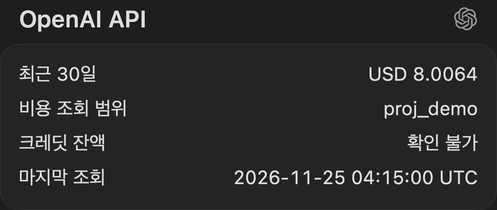

# OpenAI API 조직 비용

OpenAI API Platform 조직이 보고한 오늘 포함 최근 30일의 비용을 UTC 기준으로 조회.
조직 전체 또는 지정한 프로젝트만 조회 가능.
[Codex 계정](/docs/providers/codex.md)의 구독 한도와는 별도로 등록.

## 계정 등록

1. API Platform 조직 오너가 조직 비용 조회 권한이 있는 Admin API 키 발급. [OpenAI 관리자 키 안내](https://help.openai.com/en/articles/9687866-admin-and-audit-logs-api-for-the-api-platform)
2. **Accounts → Add Account → OpenAI API**에서 키 입력.
3. 특정 프로젝트만 조회하려면 **Project IDs**에 프로젝트 ID를 쉼표로 구분해 입력.
   비워 두면 조직 전체 조회.
4. **Add Account**를 눌러 저장.

키는 이 Mac의 egasu 전용 Keychain 항목에 저장.
조직 비용 읽기에만 사용하며 egasu는 관리 API에 쓰기 요청을 보내지 않음.
이 API의 참조 문서에는 관리자 키에 선택할 세부 권한 식별자가 명시되어 있지 않음.
계정 상세의 **Edit Billing Connection…**에서 프로젝트나 키 변경 가능.
키 입력란을 비워 두면 Keychain에서 기존 키를 확인한 뒤 프로젝트 설정 저장.
계정을 제거하면 키와 프로젝트 필터도 삭제.

## 표시 기준

*테스트용 계정의 프로젝트 `proj_demo` 표시 예시.*

- **Last 30 Days** — 일별 비용을 통화별로 합산.
  1센트 미만 금액과 음수 조정액도 API가 반환한 정밀도로 표시.
  비용 항목을 받지 못하면 **No costs reported**, 0이 보고되면 해당 통화와 0 표시.
- **Billing Scope** — 조직 전체 또는 조회한 프로젝트 ID.
- **Credit Balance** — 비용 응답은 크레딧 잔액과 만료일을 제공하지 않아 확인 불가.
- **Last Updated** — 마지막으로 모든 페이지를 조회한 시각.
  같은 키와 조회 범위에서 새로고침이 실패하면 마지막 정상 결과와 현재 오류 표시.
  앱 밖에서 키를 교체하거나 삭제하면 다음 프로바이더 새로고침 또는 CLI 조회에서 변경을 확인하고 이전 조직의 비용 숨김.
  이때 Keychain 키를 확인할 수 없어도 이전 비용 숨김.

`egasu openai-api --force`로 이 연결의 비용 조회와 캐시 갱신 가능.
CLI의 한도 응답에는 잔액이나 사용 한도를 제공할 수 없어 비용 합계를 표시하지 않음.
[로컬 HTTP API](/docs/local-http-api.md)의 `/v1/usage/openai-api`는 앱의 비용 카드와 같은 마지막 갱신 결과를 반환.
앱 밖에서 키를 바꾼 뒤 앱이 새로고침하기 전까지는 로컬 HTTP API에서도 이전 비용이 보일 수 있음.

고정된 OpenAI 주소의 `GET /v1/organization/costs`에 기간과 프로젝트 필터를 전달.
다음 페이지가 있으면 같은 조건으로 끝까지 조회. [Costs API](https://developers.openai.com/api/reference/resources/admin/subresources/organization/subresources/usage/methods/costs)
조회 중 키나 프로젝트 설정이 바뀌거나 계정이 제거되면 이전 연결의 페이지 조회 중단.
