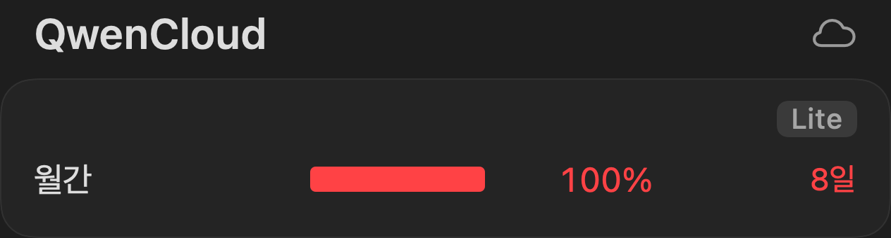

# QwenCloud 개인 Token Plan

QwenCloud CLI에 로그인한 개인 구독의 기본 크레딧 사용률과 다음 초기화 시각 표시.



## 연결

CLI 로그인 파일의 기본 위치는 `~/.qwencloud/credentials`이며 `QWENCLOUD_CONFIG_DIR`로 변경 가능.
CLI v1.7.0의 `auth login`도 기존 평문 파일을 읽으면서 이전·삭제할 수 있음.
Keychain에 저장하지 못하면 같은 경로에 쓴 암호화 파일까지 삭제될 수 있어, 기존 평문 파일의 안전한 보관이 로그인 명령보다 먼저 필요. [공식 CLI 로그인](https://github.com/QwenCloud/qwencloud-cli/blob/v1.7.0/src/commands/auth/login.ts#L73-L80) · [평문 이전](https://github.com/QwenCloud/qwencloud-cli/blob/v1.7.0/src/auth/credentials.ts#L130-L146) · [저장 경로](https://github.com/QwenCloud/qwencloud-cli/blob/v1.7.0/src/auth/credentials.ts#L220-L240)

1. [공식 CLI 안내](https://docs.qwencloud.com/api-reference/preparation/cli)에 따라 QwenCloud CLI 설치.
2. 기존 평문 `credentials` 파일이 있으면 CLI 설정 폴더 밖의 본인만 읽을 수 있는 새로운 위치로 옮겨 보관.
3. `QWENCLOUD_KEYRING=plaintext` 설정이 남아 있으면 해당 평문 저장 설정 해제.
4. 저장된 Keychain 로그인이나 암호화 파일이 없으면 터미널에서 `qwencloud auth login`으로 로그인.
5. egasu의 Accounts → Add New Account에서 QwenCloud를 선택한 뒤 **Turn On** 클릭.

새 로그인과 egasu 조회가 정상임을 확인하기 전에는 보관본 유지.
로그인에 실패하면 보관본을 유지한 채 CLI 수정 여부나 공식 지원부터 확인.
이전 파일을 복구해야 하면 원래 경로가 비어 있을 때만 보관본을 복사하고 보관본은 유지.
Keychain 로그인 성공 후 `credentials` 파일이 없는 것은 정상일 수 있으므로 파일 부재만으로 평문 보관본을 복구하지 않음.
`QWENCLOUD_KEYRING=plaintext`이면 기존 암호화 파일이 있어도 개인 Token Plan 조회와 자동 감지 중단. [공식 CLI의 인증 조건](https://github.com/QwenCloud/qwencloud-cli/blob/v1.7.0/src/auth/cs-data-session.ts#L84-L90)
이 설정을 해제한 뒤 egasu를 재실행하면 기존 암호화 파일로 조회 가능.

자동 감지는 실행 가능한 CLI와 CLI 로그인 파일 또는 Keychain 항목의 존재를 로컬에서 확인.
키와 토큰은 CLI가 관리.
암호화 파일로만 로그인한 경우 같은 파일에서 조회한 사용률을 재사용.
CLI 실행 중 암호화 파일이 바뀌면 해당 조회 결과를 폐기.
파일이 바뀐 뒤 새 조회에 실패하면 이전 사용률 숨김.
Keychain 로그인이나 저장소 확인 실패 시에는 새로고침마다 CLI로 조회하고, 실패하면 이전 사용률 숨김.
조회 도중 로그아웃이 확인되거나 CLI가 사라지면 해당 조회 결과를 폐기.
CLI 실행 도중 Keychain 항목이 다른 계정으로 교체되었는지는 확인할 수 없음.
Keychain에서도 조회에 성공하면 카드와 로컬 API `/v1/limits/qwencloud`에 현재 사용률 표시.
소프트 한도 기능을 켠 경우, CLI 사전 검사(`egasu soft-limit check qwencloud`)는 계정 신원을 확인할 수 없는 Keychain 로그인에서 `unknown` 반환.
평문 파일이 있으면 egasu가 CLI를 실행하지 않고 Keychain 또는 암호화 파일 로그인 안내를 표시.

## 사용량

egasu는 새로고침할 때 다음 명령을 실행.

```sh
qwencloud subscription tokenplan status --edition individual --format json
```

CLI가 보고한 기간에 따라 주간 또는 월간 기본 크레딧 사용률 표시.
초기화 시각이 빠진 응답은 사용률만 표시.
구독 종료일은 갱신 카운트다운에 사용하지 않음.
기본 크레딧을 모두 써도 추가 팩이 남아 있으면 계속 사용 가능. [크레딧 차감 순서](https://docs.qwencloud.com/token-plan/token-plan-usage-quota)

CLI 미설치, 로그인 필요, 개인 구독 없음, 사용률 미제공, 조회 실패는 별도 안내.
팀 구독과 종량제 지출은 개인 구독 카드의 집계 범위에서 제외.
